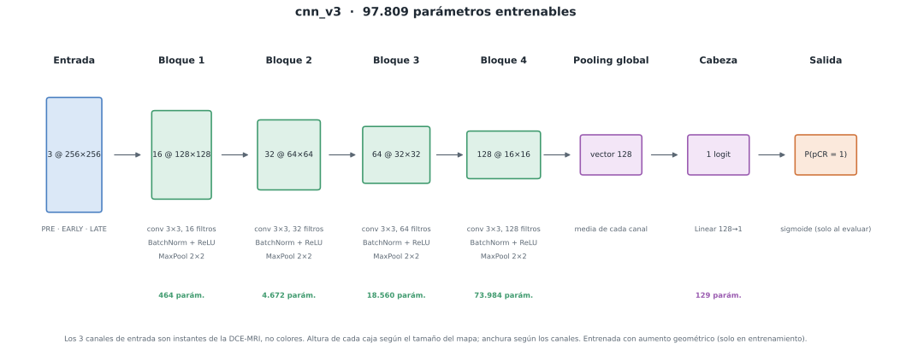

# Predicción de pCR con DCE-MRI · Caso BreastDCEDL

CNN 2D construida desde cero con PyTorch para estimar, a partir de una resonancia
de mama con contraste tomada **antes** de la quimioterapia, la probabilidad de
respuesta patológica completa (pCR). Trabajo individual de la asignatura de
Aprendizaje Automático (UAX).

> Uso exclusivamente educativo. **No tiene validez clínica** ni es un dispositivo médico.

- Enunciado oficial: [`breastdcedl/documentation/caso_breastdcedl.pdf`](breastdcedl/documentation/caso_breastdcedl.pdf)
- Guía del caso: [`breastdcedl/GUIA.md`](breastdcedl/GUIA.md)
- **App web:** <https://huggingface.co/spaces/judithsalas/breastdcedl-pcr> (cómo se publica: [App web](#app-web))
- **Diapositivas:** [`presentacion/`](presentacion/): portada, las 5 de contenido y «gracias» (PPTX con notas del orador, y PDF)
- **Experimentos del modelo final:** [`experimentos/`](experimentos/)
- **Resultados** (auditoría, cierre del modelo, médico y test): [`docs/resultados/`](docs/resultados/), una carpeta por paso

## Resultado

Solo con la imagen, la CNN acierta poco: AUC por paciente de 0,554 ± 0,043 en validación cruzada
y 0,540 en test, que se evaluó una sola vez. Las dos cifras cuadran, pero el intervalo de test
incluye el 0,5: con 176 pacientes no se puede afirmar que acierte más que el azar. Un modelo
clínico sencillo y sin imagen («el médico»: edad, menopausia, HR y HER2) queda por encima.

| AUC por paciente | Validación cruzada (train, 5 folds) | Test (176 pacientes, una sola vez) |
|---|---|---|
| CNN (solo imagen) | 0,554 ± 0,043 | 0,540 (IC 95 % 0,45–0,63) |
| Médico (sin imagen) | 0,689 ± 0,024 | 0,664 (0,57–0,76) |
| CNN + médico | 0,693 ± 0,026 | 0,674 (0,58–0,76) |
| Solo la cohorte | 0,549 ± 0,027 | — |
| Solo el subtipo HR/HER2 | 0,657 ± 0,028 | — |

- Con el umbral elegido en train (0,307), en test la CNN detecta 10 de las 53 pacientes con pCR y
  el médico, 21. Especificidad de la CNN 0,805; precisión 0,294.
- En test, la diferencia CNN − médico es −0,125 (IC 95 % −0,259 a +0,009), y lo que añade la imagen
  al médico, +0,009 (−0,006 a +0,026): con 176 pacientes, ninguna de las dos se puede demostrar.
- Las variables clínicas solo sirven de comparación: no entran en la CNN ni en la app.

## El modelo final

Un conjunto de **30 CNN propias**, entrenadas desde cero: 6 versiones de la red, cada una con los
5 modelos de su validación cruzada (uno por fold). Está en
[`experimentos/modelo_final/`](experimentos/modelo_final/) (huella `86efe7b4b112`) y lo usan, con el
mismo código, la evaluación de test y las apps.

**La red base, cnn_v3** (97.809 parámetros):



- Entrada: las tres fases de un corte (PRE, EARLY y LATE) como 3 canales de 256 × 256, en gris de
  8 bits divididos entre 255. Son tres instantes de la misma resonancia, no colores.
- 4 bloques de 16, 32, 64 y 128 filtros. Cada bloque: convolución 3 × 3, BatchNorm, ReLU y
  MaxPool 2 × 2. Parámetros por bloque: 464, 4.672, 18.560 y 73.984.
- Pooling global (un valor por canal: 128) y una capa lineal hasta un logit (129 parámetros).
- Entrenamiento: Adam, learning rate 0,001, lotes de 32 cortes, semilla 42 y aumento geométrico
  (volteo horizontal, giro de hasta 10°, desplazamiento y escala pequeños). 6 épocas fijas: se usa
  la última, sin elegirla con la validación.

**Las otras cinco versiones** cambian una sola cosa respecto a cnn_v3:

| Versión | Qué cambia | Parámetros |
|---|---|---|
| cnn_v4 | la red calcula dentro EARLY − PRE (realce) y LATE − EARLY (lavado) y los añade como canales | 98.097 |
| cnn_v5 | las tres fases se dividen entre la intensidad media del PRE en el tejido del corte | 97.809 |
| cnn_v6 | pooling por atención (media ponderada con pesos aprendidos) en vez de la media global | 101.970 |
| cnn_v7 | dropout 0,3 antes de la capa final y AdamW con weight decay 0,05 | 97.809 |
| cnn_v10 | el aumento añade giros de 0°, 90°, 180° o 270° al azar | 97.809 |

Entraron todas las versiones con validación cruzada completa que no sobreajustan (diferencia de
AUC train − validación ≤ 0,15), una regla fijada antes de mirar cuánto da el conjunto.

**De 30 logits a una respuesta**, para cada paciente:
1. en cada corte, media de los logits de los 5 modelos de cada versión, y media entre las 6
   versiones;
2. calibración de Platt, ajustada con las predicciones fuera de fold de train:
   logit calibrado = 0,187 · logit − 0,688;
3. media de las probabilidades de los cortes de la paciente;
4. umbral 0,307 (la mayor sensibilidad con especificidad ≥ 0,80 en train): por encima, «pCR»; por
   debajo, «no pCR».

Las versiones están en [`src/models/versiones.py`](src/models/versiones.py), la red configurable en
[`src/models/cnn.py`](src/models/cnn.py) y el modelo final, en [`src/models/final.py`](src/models/final.py).

## Experimentos

[`experimentos/`](experimentos/) guarda una **copia exacta** de las 6 ejecuciones del modelo final
(cada una con su configuración, sus gráficas, sus predicciones y sus pesos), el modelo final y el
modelo clínico de comparación. Qué hay en cada carpeta:
[`experimentos/README.md`](experimentos/README.md).

## Estructura

```
├── breastdcedl/        material del profesor (las imágenes no se suben: se descargan)
├── src/                el código, por pasos:
│   ├── data/             1. leer y revisar los datos (auditoría, aumento, entrada de la app)
│   ├── models/           2. la red, sus 6 versiones y el modelo final
│   ├── training/         3. entrenar y validación cruzada
│   ├── evaluation/       4. cerrar el modelo, el «médico» sin imagen y test
│   ├── utils/            CPU o GPU, semilla y exportar resultados
│   └── config.py         lee config.json
├── experimentos/       las 6 ejecuciones del modelo final, el modelo final y el modelo clínico
├── docs/
│   ├── figuras/          diagramas de las 6 versiones
│   └── resultados/       lo que generan los scripts: 1_auditoria, 2_cierre, 3_clinico, 4_test
├── web/                la app web publicada: página estática con el modelo en ONNX (Hugging Face)
├── app/                ejemplos y pruebas de la app, y una versión local en Python (Streamlit)
├── presentacion/       las diapositivas (PPTX con notas del orador, y PDF)
├── config.json         parámetros de ejecución y lo que lanza src.training.experimento
└── requirements.txt    librerías con versión fija (sin PyTorch)
```

`models/`, `runs/` y `tests/` se quedan en local: no se suben (están en `.gitignore`).

## Del código al modelo final

Los resultados de la entrega ya están en `experimentos/` y en `docs/resultados/`: no hace falta
volver a entrenar. Para rehacerlo desde cero, con las imágenes descargadas:

```bash
python -m src.data.auditoria                        # 1. auditoría de datos → docs/resultados/1_auditoria/
python -m src.training.experimento                  # 2. las 6 versiones en los 5 folds, modo fijo → runs/
python -m src.evaluation.cerrar_modelo --modo fijo  # 3. modelo final → experimentos/modelo_final/ y docs/resultados/2_cierre/
python -m src.evaluation.modelo_clinico             # 4. el «médico» sin imagen y CNN + médico → docs/resultados/3_clinico/
python -m src.evaluation.validacion_interna         #    Platt y umbral sin el fold que se mide → docs/resultados/2_cierre/
python -m src.evaluation.evaluar_test               # 5. test, UNA sola vez → docs/resultados/4_test/
```

`evaluar_test` se niega a ejecutarse si test ya se evaluó: la regla es una sola vez.

## Puesta en marcha

El proyecto se trabaja desde dos máquinas con el **mismo entorno**: Python 3.12,
las mismas librerías y la misma versión de PyTorch. Solo cambia la variante de
PyTorch según el hardware.

| | Portátil | PC Universidad |
|---|---|---|
| Sistema | Windows | Ubuntu |
| GPU | ninguna útil → **CPU** | AMD Radeon RX 6700 XT 12 GB → **ROCm** |
| Uso habitual | código, datos, modo `rapido`, app | modos `completo` y `fijo` (entrenamientos reales) |

### 1. Clonar

En Windows, en una ruta corta y fuera de OneDrive (límite de 260 caracteres en rutas):

```powershell
git clone https://github.com/judithsalas/breastdcedl.git C:\breastdcedl
```

### 2. Entorno conda

**Primera vez en una máquina:**

```bash
conda create -n cancer python=3.12 pip -y   # crea el entorno "cancer" con Python 3.12
# Aislar el entorno de los paquetes instalados fuera de él (carpeta de usuario de Python):
conda env config vars set PYTHONNOUSERSITE=1 -n cancer
conda activate cancer
pip install -r requirements.txt         # las librerías, con su versión fija
```

Si el entorno `cancer` ya existe (PC Universidad):

```bash
conda env config vars set PYTHONNOUSERSITE=1 -n cancer
conda activate cancer
pip install -r requirements.txt
```

### 3. Instalar PyTorch (distinto en cada máquina, misma versión)

**Portátil (CPU):**

```bash
pip install torch==2.14.0 torchvision==0.29.0 --index-url https://download.pytorch.org/whl/cpu
```

**PC Universidad (ROCm):**

```bash
pip install torch==2.14.0 torchvision==0.29.0 --index-url https://download.pytorch.org/whl/rocm7.14
# La RX 6700 XT (gfx1031) se hace pasar por gfx1030. Se guarda en el entorno una sola vez:
conda env config vars set HSA_OVERRIDE_GFX_VERSION=10.3.0
conda deactivate && conda activate cancer
```

Comprobar la instalación:

```bash
python -m src.utils.dispositivo
```

### 4. Descargar las imágenes

El material del profesor ya está en el repo. Esto solo descarga lo que falta (las ~38.000 PNG):

```bash
python breastdcedl/descargar_datos.py --destino breastdcedl
```

Debe terminar con `COMPLETO: 38109 imagenes`. Si se corta, se vuelve a lanzar y continúa.
Si las imágenes ya están en otra carpeta del ordenador, es más rápido moverlas a
`breastdcedl/dataset/` que volver a descargarlas.

### 5. Comprobar que todo funciona

```bash
ruff check .                          # el mismo lint que GitHub Actions
python -m src.models.comprobar cnn_v3 # capas, tamaños y parámetros de la red base
```

## Modos de ejecución

| | `rapido` | `completo` | `fijo` |
|---|---|---|---|
| Para qué | comprobar que el código funciona | entrenamiento real | entrenamiento real sin elegir la época (el del modelo final) |
| Datos | 40 pacientes | todas las de train | todas las de train |
| Épocas | 2 | hasta 60, para si no mejora en 10 | 6, se usa la última |
| Batch | 16 | 32 | 32 |
| AUC de entrenamiento | sobre sus 40 pacientes | sobre 220 pacientes fijas de train | sobre 220 pacientes fijas de train |
| ¿Sus métricas cuentan? | **no** | sí | sí |

Los valores están en [`config.json`](config.json), con una explicación de cada parámetro en `_ayuda`.
Su sección `experimento` es lo que lanza `src.training.experimento`: ahora, las 6 versiones del
modelo final en modo `fijo` y en los 5 folds.

```bash
python -m src.training.experimento --ver                             # qué se va a lanzar
nohup python -m src.training.experimento > experimento.log 2>&1 &   # lanzarlo (es reanudable)
python -m src.training.comparar cnn_v3 cnn_v10                       # comparar dos versiones en el fold 0
```

El modo `rapido` usa solo pacientes ya descargadas, así que funciona con una descarga
parcial (`descargar_datos.py --pacientes 100` basta).

## Entrenar una versión

```bash
python -m src.models.comprobar cnn_v3      # forma de cada capa y parámetros, sin entrenar
python -m src.models.dibujar cnn_v3        # diagrama de bloques en docs/figuras/

python -m src.training.entrenar --modo rapido --modelo cnn_v3                # prueba de humo (1-2 minutos)
python -m src.training.entrenar --modo completo --modelo cnn_v3              # un fold, pérdida normal
python -m src.training.entrenar --modo completo --modelo cnn_v3 --ponderada  # un fold, pérdida ponderada
python -m src.training.validacion_cruzada --modo fijo --modelo cnn_v3        # los 5 folds: media ± desviación

python -m src.training.historico           # el histórico de ejecuciones (runs/historico.csv)
python -m src.training.graficas runs/*     # rehacer las gráficas de las ejecuciones
```

Cualquier valor del modo se puede cambiar al lanzar: `--batch`, `--epocas`, `--paciencia`,
`--lr`, `--fold` (solo en `entrenar`), `--folds 0 1 2` (solo en `validacion_cruzada`),
`--pacientes`, `--pacientes-auc-train`, `--workers`, `--semilla`. Con `--nota "texto"` se guarda un
comentario junto a los resultados.

Cada entrenamiento deja en `runs/<fecha>_<modelo>_<modo>/` (en local):

| Fichero | Qué tiene |
|---|---|
| `resultados.json` | configuración, máquina, tiempos, memoria, métricas por época y la época usada (`mejor_epoca`) con su matriz de confusión, métricas por clase y diferencia de AUC entrenamiento − validación |
| `historial.csv` | métricas por época en tabla: pérdida y AUC de entrenamiento y validación, sensibilidad, especificidad, F1 |
| `mejor.pt` | pesos de la época usada |
| `predicciones_val.csv`, `predicciones_val_pacientes.csv` | probabilidades de esa época, por corte y por paciente (con su cohorte) |
| `graficas/` | `curvas.png` (entrenamiento y validación por época) y `matriz_confusion.png` |

Una validación cruzada deja una carpeta `runs/<fecha>_cv_<modelo>_<modo>/` con un `fold_k/` como
el de arriba por fold, más `config_usada.json` (si la lanzó `src.training.experimento`),
`resumen.json` y `resumen.csv` (media ± desviación), `predicciones_oof*.csv` (todas las pacientes,
fuera de fold) y `graficas/` (curvas de todos los folds y matriz fuera de fold). Cada ejecución
añade o actualiza su fila en `runs/historico.csv`.

Para revisar los resultados en otro ordenador sin copiar imágenes ni pesos:
`python -m src.utils.exportar_resultados` (un zip pequeño en la raíz del repo, que no se sube).

## App web

La app publicada es una página propia (`web/`) en un Space **estático** de Hugging Face, gratis. El modelo
final se ejecuta en el navegador de quien la usa, con ONNX Runtime Web: las imágenes no salen de su
ordenador. `web/modelo/modelo.onnx` se exporta del modelo final y, antes de publicarlo, se comprueba que
da lo mismo que PyTorch.

Tiene tres páginas:
- **Predicción** (`index.html`): se sube un corte, una imagen en cada hueco (PRE, EARLY y LATE) y con
  cualquier nombre, o se elige un ejemplo, y da la probabilidad, la clase («pCR» o «no pCR») y el mapa de qué
  zonas la suben o la bajan.
- **La red** (`red.html`): la arquitectura pieza a pieza, con un corte atravesándola, sus mapas de
  características reales y los parámetros de cada capa.
- **Resultados** (`resultados.html`): la CNN frente al modelo del médico y a los dos juntos, con las
  gráficas que piden las guías (ROC, calibración, curva de decisión, subgrupos…).

**La primera vez** (en el PC de la uni, con el entorno `cancer`):

1. Crear una cuenta en <https://huggingface.co> (gratis).
2. En *Settings → Access Tokens*, crear un token de tipo **Write** y copiarlo.
3. Guardarlo en el ordenador:
   ```bash
   python -c "from huggingface_hub import login; login()"   # pegar el token cuando lo pida
   ```

**Cada vez que cambie la web:**

```bash
python -m src.models.publicar_web <usuario>/breastdcedl-pcr  # crea el Space si no existe y sube web/
```

Si cambian el modelo final o los ejemplos, antes: `python -m src.models.exportar_web` (rehace
`web/modelo`, `web/ejemplos` y `web/datos`, comprobados con PyTorch).

Publicada el 2026-10-29 en <https://huggingface.co/spaces/judithsalas/breastdcedl-pcr>. Para probarla con entradas
válidas e inválidas: `python -m app.casos_prueba` y la lista de `pruebas_app/LEEME.md`.

**Probarla en local** (opcional): `python -m http.server -d web 8000` y abrir <http://localhost:8000>.
La versión en Python, también en local: `streamlit run app/app.py` (ver [`app/README.md`](app/README.md)).

## Licencias y atribución

Los datos derivan de **BreastDCEDL** (Fridman et al., *Scientific Data*, 2026,
[doi:10.1038/s41597-026-06589-6](https://doi.org/10.1038/s41597-026-06589-6)).
Uso docente y de investigación; ver [`breastdcedl/LICENSE`](breastdcedl/LICENSE) y la sección
de ética de la guía.
