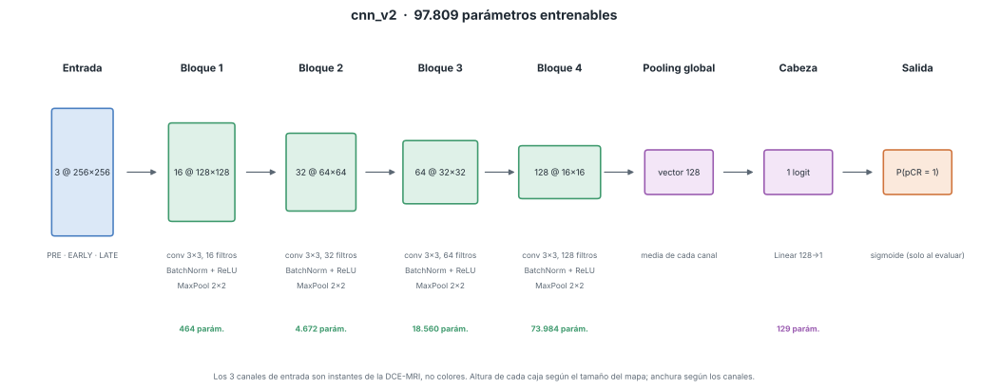

# Predicción de pCR con DCE-MRI · Caso BreastDCEDL

CNN 2D construida desde cero con PyTorch para estimar, a partir de una resonancia
de mama con contraste tomada **antes** de la quimioterapia, la probabilidad de
respuesta patológica completa (pCR). Trabajo individual de la asignatura de
Aprendizaje Automático (UAX).

> Uso exclusivamente educativo. **No tiene validez clínica** ni es un dispositivo médico.

- Enunciado oficial: [`breastdcedl/documentation/caso_breastdcedl.pdf`](breastdcedl/documentation/caso_breastdcedl.pdf)
- Guía del caso: [`breastdcedl/GUIA.md`](breastdcedl/GUIA.md)
- **App web:** <https://huggingface.co/spaces/judithsalas/breastdcedl-pcr> (cómo se publica: [App web](#app-web))

## Por dónde empezar

Hay **tres documentos para leer**, todos en `docs/`. Lo demás lo genera el código.

| Si quieres… | Abre |
|---|---|
| saber **en qué punto estamos** y qué toca ahora | [`docs/REGISTRO.md`](docs/REGISTRO.md) → «Estado actual» |
| **entender y defender** una decisión (explicada desde cero) | [`docs/COMO_SE_HIZO.md`](docs/COMO_SE_HIZO.md) |
| ver la **historia de la red**, versión a versión | [`docs/ARQUITECTURAS.md`](docs/ARQUITECTURAS.md) |
| ver **resultados** (auditoría, modelo final, médico, test) | [`docs/resultados/`](docs/resultados/), una carpeta por paso |

Qué va en cada sitio y cómo se sigue un resultado hasta su origen: D14 y D26 del registro.

## Arquitecturas

Estado, resultados y motivo de cada versión: [`docs/ARQUITECTURAS.md`](docs/ARQUITECTURAS.md).
Las definiciones están en [`src/models/versiones.py`](src/models/versiones.py) y los diagramas se
generan desde el código (`python -m src.models.dibujar cnn_v2`):



## Estructura

```
├── breastdcedl/        material del profesor: no se toca
│   └── dataset/        las imágenes PNG (no se suben a GitHub; se descargan)
├── src/                el código, por pasos:
│   ├── data/             1. leer y revisar los datos (auditoría, aumento, entrada de la app)
│   ├── models/           2. las redes (versiones), el modelo final y su historial
│   ├── training/         3. entrenar, validación cruzada y plan de experimentos
│   ├── evaluation/       4. cerrar el modelo, el «médico» sin imagen y test
│   ├── utils/            CPU o GPU, semilla
│   └── config.py         lee config.json
├── tests/              comprobaciones automáticas (`pytest -q`)
├── web/                la app web publicada: página estática con el modelo en ONNX (Hugging Face, D38)
├── app/                ejemplos y pruebas de la app, y una versión local en Python (Streamlit)
├── docs/
│   ├── COMO_SE_HIZO.md   las decisiones, explicadas
│   ├── ARQUITECTURAS.md  la historia de la red
│   ├── REGISTRO.md       el diario: estado, decisiones, rúbrica
│   ├── figuras/          diagramas de las redes y gráficas copiadas de los entrenamientos
│   └── resultados/       lo que generan los scripts: 1_auditoria, 2_cierre, 3_clinico, 4_test
├── models/
│   ├── final/            el modelo final (pesos que usa la app)
│   └── clinico/          el «médico» sin imagen (un JSON pequeño)
├── runs/               cada entrenamiento (solo en tu ordenador; a GitHub va historico.csv)
├── config.json         parámetros de ejecución y plantilla de experimentos (D31)
├── environment.yml     entorno conda (Python 3.12)
└── requirements.txt    librerías con versión fija (sin PyTorch)
```

## Del código a la entrega

Orden y comandos completos, explicados: [`docs/COMO_SE_HIZO.md` §9](docs/COMO_SE_HIZO.md#9-qué-queda-y-en-qué-orden).

```bash
python -m src.data.auditoria             # 1. auditoría de datos → docs/resultados/1_auditoria/
python -m src.training.plan              # 2. plan de experimentos (una noche, reanudable)
python -m src.utils.exportar_resultados  #    resultados en un zip pequeño (sin imágenes ni pesos)
python -m src.evaluation.cerrar_modelo   # 3. modelo final → models/final/ y docs/resultados/2_cierre/
python -m src.evaluation.modelo_clinico  # 4. el «médico» sin imagen y CNN + médico → docs/resultados/3_clinico/
python -m src.evaluation.validacion_interna  #  Platt y umbral sin el fold que se mide → docs/resultados/2_cierre/
python -m app.preparar_ejemplos          # 5. ejemplos de la app
python -m src.models.exportar_web        #    la app web: modelo en ONNX, comprobado con PyTorch → web/
python -m src.models.publicar_web <usuario>/breastdcedl-pcr   #    la sube a Hugging Face
python -m src.evaluation.evaluar_test    # 6. test, UNA sola vez → docs/resultados/4_test/
streamlit run app/app.py                 # versión local en Python (opcional)
```

## Puesta en marcha

El proyecto se trabaja desde dos máquinas con el **mismo entorno**: Python 3.12,
las mismas librerías y la misma versión de PyTorch. Solo cambia la variante de
PyTorch según el hardware.

| | Portátil | PC Universidad |
|---|---|---|
| Sistema | Windows | Ubuntu |
| GPU | ninguna útil → **CPU** | AMD Radeon RX 6700 XT 12 GB → **ROCm** |
| Uso habitual | código, datos, modo `rapido`, app | modo `completo` (entrenamientos reales) |

### 1. Clonar

En Windows, en una ruta corta y fuera de OneDrive (límite de 260 caracteres en rutas):

```powershell
git clone https://github.com/judithsalas/breastdcedl.git C:\breastdcedl
```

### 2. Entorno conda

**Primera vez en una máquina:**

```bash
conda env create -f environment.yml     # crea "cancer" con Python 3.12 + requirements.txt
# Aislar el entorno de los paquetes instalados fuera de él (carpeta de usuario de Python):
conda env config vars set PYTHONNOUSERSITE=1 -n cancer
conda activate cancer
pip install -r requirements.txt         # reinstala dentro del entorno lo que pip encontró fuera
```

Si el entorno `cancer` ya existe (PC Universidad):

```bash
conda env config vars set PYTHONNOUSERSITE=1 -n cancer
conda activate cancer
pip install -r requirements.txt
```

### 3. Instalar PyTorch (distinto en cada máquina, misma versión)

**Portátil (CPU):**

```bash
pip install torch==2.14.0 torchvision==0.29.0 --index-url https://download.pytorch.org/whl/cpu
```

**PC Universidad (ROCm):**

```bash
pip install torch==2.14.0 torchvision==0.29.0 --index-url https://download.pytorch.org/whl/rocm7.14
# La RX 6700 XT (gfx1031) se hace pasar por gfx1030. Se guarda en el entorno una sola vez:
conda env config vars set HSA_OVERRIDE_GFX_VERSION=10.3.0
conda deactivate && conda activate cancer
```

Comprobar la instalación:

```bash
python -m src.utils.dispositivo
```

### 4. Descargar las imágenes

El material del profesor ya está en el repo. Esto solo descarga lo que falta (las ~38.000 PNG):

```bash
python breastdcedl/descargar_datos.py --destino breastdcedl
```

Debe terminar con `COMPLETO: 38109 imagenes`. Si se corta, se vuelve a lanzar y continúa.
Si las imágenes ya están en otra carpeta del ordenador (por ejemplo, una copia antigua del
proyecto), es más rápido moverlas a `breastdcedl/dataset/` que volver a descargarlas.

### 5. Comprobar que todo funciona

```bash
ruff check .
pytest -q
```

## Al cambiar de ordenador

```bash
git pull
conda activate cancer
pip install -r requirements.txt     # instala solo lo que haya cambiado
```

Y antes de irse: `git add`, `git commit` y **`git push`**. Lo que no está en GitHub no existe en la otra máquina.

## Modos de ejecución

| | `rapido` | `completo` |
|---|---|---|
| Para qué | comprobar que el código funciona | entrenamiento real |
| Datos | 40 pacientes | todas las de train |
| Épocas | 2 | hasta 60, para si no mejora en 10 |
| Batch | 16 | 32 (fijo para poder comparar) |
| AUC de entrenamiento | sobre sus 40 pacientes | sobre 220 pacientes fijas de train (D12) |
| ¿Sus métricas cuentan? | **no** | sí |

Los valores están en [`config.json`](config.json), con una explicación de cada parámetro en `_ayuda`.
La sección `experimento` es la plantilla para probar algo, por ejemplo una versión en un solo fold:

```bash
python -m src.training.experimento --ver                             # qué se va a lanzar
nohup python -m src.training.experimento > experimento.log 2>&1 &   # lanzarlo
python -m src.training.comparar cnn_v3 cnn_v10                       # seguirlo frente a cnn_v3
```

El modo `rapido` usa solo pacientes ya descargadas, así que funciona con una descarga
parcial (`descargar_datos.py --pacientes 100` basta).

## Diseñar y entrenar una red

```bash
# 1. Comprobar la arquitectura sin entrenar: forma de cada capa y parámetros
python -m src.models.comprobar cnn_v1
python -m src.models.dibujar cnn_v1      # diagrama de bloques en docs/figuras/

# 2. Prueba de humo (1-2 minutos): que todo funciona
python -m src.training.entrenar --modo rapido --modelo cnn_v1

# 3. Entrenamiento real en un fold, con pérdida normal y ponderada (el enunciado pide comparar)
python -m src.training.entrenar --modo completo --modelo cnn_v2
python -m src.training.entrenar --modo completo --modelo cnn_v2 --ponderada

# 4. Validación cruzada: la misma red en los 5 folds, media ± desviación (lo que va al informe)
python -m src.training.validacion_cruzada --modo completo --modelo cnn_v2
python -m src.training.validacion_cruzada --modo completo --modelo cnn_v2 --ponderada

# Ver el histórico de ejecuciones y rehacer gráficas (por ejemplo, de ejecuciones antiguas)
python -m src.training.historico
python -m src.training.graficas runs/*

# Historial de arquitecturas: regenerar sus tablas y copiar las gráficas de una ejecución
python -m src.models.historial
python -m src.models.historial --figuras runs/<ejecución>
```

Para una versión nueva, antes de entrenar: entrada en `versiones.py` con su `ORIGEN` y `ESTADO`
y ficha en `docs/ARQUITECTURAS.md` con la hipótesis (los tests lo comprueban):

```bash
python -m src.models.comprobar cnn_v3     # capas, tamaños y parámetros
python -m src.models.dibujar cnn_v3       # diagrama en docs/figuras/
```

Cualquier valor del modo se puede cambiar al lanzar: `--batch`, `--epocas`, `--paciencia`,
`--lr`, `--fold` (solo en `entrenar`), `--folds 0 1 2` (solo en `validacion_cruzada`),
`--pacientes`, `--pacientes-auc-train`, `--workers`, `--semilla`. Con `--nota "texto"` se guarda un
comentario junto a los resultados.

Cada ejecución deja en `runs/<fecha>_<modelo>_<modo>/` (no se versiona):

| Fichero | Qué tiene |
|---|---|
| `resultados.json` | configuración, máquina, tiempos, memoria, métricas por época y la época elegida (`mejor_epoca`) con su matriz de confusión, métricas por clase y diferencia de AUC entrenamiento − validación |
| `historial.csv` | métricas por época en tabla: pérdida y AUC de entrenamiento y validación, sensibilidad, especificidad, F1 |
| `mejor.pt` | pesos de la época elegida (mejor AUC por paciente en validación) |
| `predicciones_val.csv`, `predicciones_val_pacientes.csv` | probabilidades de la época elegida, por corte y por paciente (con su cohorte) |
| `graficas/` | `curvas.png` (entrenamiento y validación por época) y `matriz_confusion.png` |

Una validación cruzada deja una carpeta `runs/<fecha>_cv_<modelo>_<modo>/` con un `fold_k/` como
el de arriba por fold, más `resumen.json` y `resumen.csv` (media ± desviación),
`predicciones_oof*.csv` (todas las pacientes, fuera de fold) y `graficas/` (curvas de todos los
folds y matriz fuera de fold).

Además, cada ejecución añade o actualiza su fila en **`runs/historico.csv`**, el único fichero de
`runs/` que se versiona: una fila por ejecución (una por validación cruzada) con la época elegida y
sus métricas, para comparar todo lo entrenado en las dos máquinas.

Las arquitecturas se declaran en [`src/models/versiones.py`](src/models/versiones.py): cada
versión (`cnn_v1`, `cnn_v2`...) es una lista de decisiones (filtros por bloque, kernel,
convoluciones por bloque, pooling, BatchNorm, resumen global o flatten, cabeza, dropout) para la
CNN configurable de [`src/models/cnn.py`](src/models/cnn.py). Para probar una idea nueva se añade
una versión cambiando solo lo que se quiere comparar; las versiones ya entrenadas no se tocan.

## Licencias y atribución

Los datos derivan de **BreastDCEDL** (Fridman et al., *Scientific Data*, 2026,
[doi:10.1038/s41597-026-06589-6](https://doi.org/10.1038/s41597-026-06589-6)).
Uso docente y de investigación; ver [`breastdcedl/LICENSE`](breastdcedl/LICENSE) y la sección
de ética de la guía.

## App web

La app publicada es una página propia (`web/`) en un Space **estático** de Hugging Face, gratis. El modelo
final se ejecuta en el navegador de quien la usa, con ONNX Runtime Web: las imágenes no salen de su
ordenador. Por qué así y cómo se garantiza que da lo mismo que el pipeline:
[`docs/COMO_SE_HIZO.md` §7](docs/COMO_SE_HIZO.md#7-la-app) y D38 del registro.

Tiene tres páginas (D39):
- **Predicción** (`index.html`): se suben las tres fases de un corte, o se elige un ejemplo, y da la
  probabilidad, la clase y el mapa de qué zonas la suben o la bajan.
- **La red** (`red.html`): la arquitectura pieza a pieza, con un corte atravesándola, sus mapas de
  características reales y los parámetros de cada capa.
- **Resultados** (`resultados.html`): la CNN frente al modelo del médico y a los dos juntos, con las
  gráficas que piden las guías (ROC, calibración, curva de decisión, subgrupos…).

**La primera vez** (en el PC de la uni, con el entorno `cancer`):

1. Crear una cuenta en <https://huggingface.co> (gratis).
2. En *Settings → Access Tokens*, crear un token de tipo **Write** y copiarlo.
3. Guardarlo en el ordenador:
   ```bash
   python -c "from huggingface_hub import login; login()"   # pegar el token cuando lo pida
   ```

**Cada vez que cambie el modelo final o los ejemplos:**

```bash
python -m src.models.exportar_web                            # web/modelo, web/ejemplos y web/datos, comprobados con PyTorch
python -m src.models.publicar_web <usuario>/breastdcedl-pcr  # crea el Space si no existe y sube web/
```

Publicada el 2026-10-29 en <https://huggingface.co/spaces/judithsalas/breastdcedl-pcr>. Para probarla con entradas
válidas e inválidas: `python -m app.casos_prueba` y la lista de `pruebas_app/LEEME.md`.

**Probarla en local** (opcional): `python -m http.server -d web 8000` y abrir <http://localhost:8000>.
