# Historial de arquitecturas

La historia del modelo: cada versión de la CNN que se prueba tiene aquí su **ficha**. La ficha
cuenta de qué versión sale, qué cambia y por qué, qué se esperaba ver, qué salió y qué se decidió.
Es la base de las diapositivas 3 y 4 y de las preguntas de la defensa sobre la arquitectura.

Las decisiones de proceso (entorno, tubería, datos) siguen en [`REGISTRO.md`](REGISTRO.md). Aquí
solo va lo que es de la red. Mapa completo de la documentación: D14 del registro.

## Cómo se usa

**Antes de entrenar una versión nueva:**
1. Añadirla en `src/models/versiones.py` cambiando **solo** lo que se quiere comparar.
2. Declarar en el mismo fichero su `ORIGEN` (de qué versión sale) y `ESTADO = "por entrenar"`.
3. Abrir su ficha aquí, copiando la [plantilla](#plantilla-para-una-versión-nueva), con el origen,
   el cambio, la hipótesis y **qué esperamos ver**. Se escribe antes de ver los resultados para no
   ajustar la explicación al resultado.

**Después de entrenar:**

4. Completar las ejecuciones, los resultados, la lectura y la decisión.
5. Actualizar `ESTADO` en `versiones.py`.
6. Copiar las gráficas que sirven de evidencia:
   `python -m src.models.historial --figuras runs/<ejecución>`. El comando imprime los enlaces para
   pegar en la ficha.

**Reglas:**
- Las tablas de abajo marcadas como automáticas se regeneran solas al terminar cada
  entrenamiento, o con `python -m src.models.historial`. No se editan a mano.
- Una versión ya entrenada no se modifica: si cambia algo, es otra versión. Cada ejecución guarda
  la **huella** de la definición que se entrenó. Si alguien cambia la versión después, su
  ejecución sale marcada con ⚠.
- cnn_v1 y cnn_v2 las decidió Judith. Desde el 2026-10-18 (D15) las decide Claude con su
  autorización: cada decisión está explicada desde cero en [`COMO_SE_HIZO.md`](COMO_SE_HIZO.md) y
  Judith puede revertirla. Los tests fallan si una versión no tiene `ORIGEN`, `ESTADO` o ficha.

**Estados:** `por entrenar` → `en prueba` → `descartada` o `candidata` → `final`.

**Criterio para comparar versiones** (fijado el 2026-10-18, D16; lo aplica el código:
`elegir_mejor` en `src/models/historial.py`):
1. Solo cuentan las validaciones cruzadas completas: modo `completo`, los 5 folds, pérdida
   normal y huella ✓ (la definición actual es la que se entrenó).
2. Se compara la **media del AUC por paciente en validación** de los 5 folds, no un fold suelto.
3. La mejor es la de mayor media. Pero toda versión cuya media quede a menos de una
   desviación de la mejor (la desviación entre folds de la mejor) se considera **empatada** con
   ella: con 219 pacientes por fold, el ruido de un fold es de ±0,04 y diferencias menores no
   significan nada.
4. Entre las empatadas se desempata en este orden:
   - primero las que **no sobreajustan** (diferencia de AUC entre entrenamiento y validación
     ≤ 0,15). La rúbrica pide descartar los modelos sobreentrenados; en las figuras del
     profesor, el bien entrenado tenía 0,10 y el sobreentrenado 0,38;
   - después, la **más simple** (menos parámetros);
   - si tienen los mismos parámetros, la más antigua (cambia menos cosas).
5. Si la ganadora sobreajusta (> 0,15), la siguiente versión debe atacar el sobreajuste.

**Referencias para leer los AUC:**

| Referencia | AUC |
|---|---|
| Azar | 0,50 |
| Solo la cohorte (R0, sin imagen) | 0,55 |
| Solo el subtipo HR/HER2 (R0, sin imagen) | 0,66 |
| El «médico»: edad, menopausia, HR y HER2 (R3, D25, sin imagen) | 0,69 |
| "Buen trabajo" en test según el profesor (cortes 2D, tres cohortes) | 0,60–0,70 |
| Fridman et al. en el mismo test (ViT preentrenado, otro método) | 0,72 |

## Resumen

Automático. AUC por paciente en validación de la **última** ejecución completa de cada tipo (no de
la mejor, para no escoger a posteriori). Todas las ejecuciones están en la tabla de abajo.
En 5 folds se da media ± desviación. ⚠ = la versión cambió después de esa ejecución.

<!-- auto:resumen:inicio -->
| Versión | Origen | Qué cambia | Parámetros | Estado | 1 fold · normal | 1 fold · ponderada | 5 folds · normal | 5 folds · ponderada | Train − val |
|---|---|---|---|---|---|---|---|---|---|
| [cnn_v1](#cnn_v1) | — | primera versión | 23.761 | descartada | — | — | — | — | — |
| [cnn_v2](#cnn_v2) | cnn_v1 | filtros: (16, 32, 64) → (16, 32, 64, 128) | 97.809 | descartada | — | — | 0,593 ± 0,032 | — | 0,162 |
| [cnn_v3](#cnn_v3) | cnn_v2 | entrenamiento.aumento: None → geometrico | 97.809 | candidata | — | — | 0,576 ± 0,037 | 0,574 ± 0,030 | 0,080 |
| [cnn_v4](#cnn_v4) | cnn_v3 | entrada: fases → fases+realce | 98.097 | descartada | — | — | 0,572 ± 0,044 | — | 0,126 |
| [cnn_v5](#cnn_v5) | cnn_v3 | normalizacion: None → pre | 97.809 | descartada | — | — | 0,574 ± 0,035 | — | 0,104 |
| [cnn_v6](#cnn_v6) | cnn_v3 | resumen: global → atencion | 101.970 | descartada | — | — | 0,591 ± 0,041 | — | 0,065 |
| [cnn_v7](#cnn_v7) | cnn_v3 | dropout: 0.0 → 0.3; entrenamiento.optimizador: adam → adamw; entrenamiento.weight_decay: 0.0 → 0.05 | 97.809 | descartada | — | — | 0,588 ± 0,042 | — | 0,103 |
| [cnn_v8](#cnn_v8) | cnn_v3 | dropout: 0.0 → 0.3; entrenamiento.optimizador: adam → adamw; entrenamiento.weight_decay: 0.0 → 0.05; normalizacion: None → pre; resumen: global → atencion | 101.970 | descartada | 0,558 | — | 0,593 ± 0,025 | — | 0,169 |
| [cnn_v10](#cnn_v10) | cnn_v3 | entrenamiento.aumento: geometrico → geometrico+giros90 | 97.809 | descartada | — | — | 0,581 ± 0,045 | — | 0,047 |
| [cnn_v11](#cnn_v11) | cnn_v3 | entrenamiento.recorte: None → caja | 97.809 | por entrenar | — | — | — | — | — |

**Según el criterio de comparación:** la mejor es **cnn_v3**: empata con cnn_v2 (0,593 ± 0,032); cnn_v2 sobreajusta (diferencia 0,162 > 0,15) y cnn_v3 no (0,080). Empatadas: cnn_v2, cnn_v3, cnn_v4, cnn_v5, cnn_v6, cnn_v7, cnn_v8, cnn_v10.
<!-- auto:resumen:fin -->

Las ejecuciones de cnn_v1 (R1, R2) se entrenaron antes de que existiera el histórico. Aparecen
aquí después de lanzar `python -m src.training.historico` en el PC de la universidad, donde
están sus carpetas. Mientras tanto, sus cifras están en la ficha.

## Genealogía

Automático: de qué versión sale cada una.

<!-- auto:genealogia:inicio -->
```
cnn_v1 · descartada
└── cnn_v2 · descartada
    └── cnn_v3 · candidata
        ├── cnn_v4 · descartada
        ├── cnn_v5 · descartada
        ├── cnn_v6 · descartada
        ├── cnn_v7 · descartada
        ├── cnn_v8 · descartada
        ├── cnn_v10 · descartada
        └── cnn_v11 · por entrenar
```
<!-- auto:genealogia:fin -->

## Ejecuciones

Automático: todas las ejecuciones en modo completo de `runs/historico.csv`. El detalle de cada
una está en `runs/<ejecución>/` (en la máquina donde se entrenó).

<!-- auto:ejecuciones:inicio -->
| Fecha | Ejecución | Versión | Pérdida | Folds | Época elegida | AUC val | AUC train | Train − val | F1 macro | Huella |
|---|---|---|---|---|---|---|---|---|---|---|
| 2026-10-20 18:43 | `20261020-184355_cv_cnn_v2_completo` | cnn_v2 | normal | 0,1,2,3,4 | 8,2 | 0,593 ± 0,032 | 0,755 | 0,162 | 0,520 | `cc7de9db` ✓ |
| 2026-10-20 19:29 | `20261020-192927_cv_cnn_v3_completo` | cnn_v3 | normal | 0,1,2,3,4 | 6,8 | 0,576 ± 0,037 | 0,656 | 0,080 | 0,427 | `4bb03d5d` ✓ |
| 2026-10-20 20:11 | `20261020-201130_cv_cnn_v4_completo` | cnn_v4 | normal | 0,1,2,3,4 | 9,4 | 0,572 ± 0,044 | 0,698 | 0,126 | 0,472 | `e7188804` ✓ |
| 2026-10-20 21:03 | `20261020-210342_cv_cnn_v3_completo_ponderada` | cnn_v3 | ponderada | 0,1,2,3,4 | 8,2 | 0,574 ± 0,030 | 0,668 | 0,094 | 0,480 | `4bb03d5d` ✓ |
| 2026-10-21 13:56 | `20261021-135616_cv_cnn_v5_completo` | cnn_v5 | normal | 0,1,2,3,4 | 8,8 | 0,574 ± 0,035 | 0,678 | 0,104 | 0,460 | `7d6803db` ✓ |
| 2026-10-21 14:43 | `20261021-144306_cv_cnn_v6_completo` | cnn_v6 | normal | 0,1,2,3,4 | 6,0 | 0,591 ± 0,041 | 0,656 | 0,065 | 0,438 | `5f5b8fc2` ✓ |
| 2026-10-21 15:23 | `20261021-152323_cv_cnn_v7_completo` | cnn_v7 | normal | 0,1,2,3,4 | 11,2 | 0,588 ± 0,042 | 0,691 | 0,103 | 0,450 | `07d7985c` ✓ |
| 2026-10-21 16:16 | `20261021-161603_cv_cnn_v8_completo` | cnn_v8 | normal | 0 | 23,0 | 0,558 | 0,658 | 0,099 | 0,500 | `6e0fa692` ✓ |
| 2026-10-21 19:22 | `20261021-192232_cv_cnn_v8_completo` | cnn_v8 | normal | 0,1,2,3,4 | 19,2 | 0,593 ± 0,025 | 0,762 | 0,169 | 0,478 | `6e0fa692` ✓ |
| 2026-10-21 20:35 | `20261021-203548_cv_cnn_v10_completo` | cnn_v10 | normal | 0,1,2,3,4 | 9,8 | 0,581 ± 0,045 | 0,628 | 0,047 | 0,451 | `a5610d0f` ✓ |
<!-- auto:ejecuciones:fin -->

---

## cnn_v1

**Primera red.** Origen: ninguno · Definida el 2026-10-07 · Diseñada por Judith ·
Estado: **descartada** (2026-10-07). Antes era D10, R1 y R2 del registro.

### Definición

Para poder iterar, la CNN es configurable (`src/models/cnn.py`) y cada versión es una lista de
decisiones en `src/models/versiones.py`.

| Decisión | cnn_v1 | Por qué |
|---|---|---|
| Bloques | 3 | La guía recomienda empezar con 3–4; red simple |
| Filtros | 16 → 32 → 64 | Pocos: red pequeña para pocos datos (~880 pacientes); término medio entre 8→16→32 y 32→64→128 |
| Kernel / padding / convs | 3×3, padding 1, 1 conv por bloque | Estándar y lo más simple; solo el pooling reduce el tamaño |
| Pooling | MaxPool 2×2 | Se queda con la respuesta más fuerte de cada zona |
| BatchNorm | Sí, tras cada conv (sin sesgo en la conv) | Entrenamiento más estable |
| De mapas a vector | Pooling global | 64 valores en vez de 65.536: muchos menos parámetros y menos sobreajuste |
| Cabeza | Linear(64 → 1), sin dropout | Con pooling global la cabeza ya es mínima (65 parámetros) |
| **Total** | **23.761 parámetros** | |

Tamaños: 3@256² → 16@128² → 32@64² → 64@32² → 64 → 1.
Diagrama: [`figuras/cnn_v1.svg`](figuras/cnn_v1.svg) (`python -m src.models.dibujar cnn_v1`).
Inicialización: la de PyTorch por defecto (pendiente de justificar, rúbrica punto 3).

### Hipótesis y qué esperábamos ver

Es la primera red, así que la hipótesis era que una CNN pequeña encuentra señal de realce en los
cortes. Se dejó escrita una consecuencia a vigilar: con 3 bloques cada punto del mapa final ve
~22×22 píxeles de 256×256, así que la red detecta patrones locales de realce y no la forma global
del tumor. "Si se queda corta, una versión con 4 bloques es la comparación natural."

### Ejecuciones

Fold 0 de validación: 219 pacientes, 64 con pCR. Agregación por media, umbral 0,5. Adam con
lr 1e-3, batch 32, paciencia 10, semilla 42. PC de la universidad (RX 6700 XT, ROCm 7.14).
Antes de D12, así que no se midió el AUC de entrenamiento.

| Id | Ejecución | Pérdida | Paró en | Época elegida | AUC val | Tiempo |
|---|---|---|---|---|---|---|
| R1 | `20261007-211625_cnn_v1_completo` | normal | 20 | 10 | 0,585 | 27 s/época (la primera 33 s) |
| R2 | `20261007-213119_cnn_v1_completo_ponderada` | ponderada (`pos_weight` = 2,40) | 20 | 10 | 0,572 | igual |

Gráficas: pendientes. Se generan en el PC de la uni con
`python -m src.training.graficas runs/2026100*` y se copian aquí con
`python -m src.models.historial --figuras runs/<ejecución>`.

### Resultados

**R1, pérdida normal:**
- Mejor AUC 0,585 (época 10). El resto de épocas, entre 0,51 y 0,58.
- Sensibilidad casi siempre 0 con umbral 0,5: la red predice "no pCR" para casi todas.
- Pérdida de entrenamiento de 0,603 a 0,524. La de validación sube desde la época 3 (de 0,60 a
  0,65–0,81): empieza a memorizar el entrenamiento sin generalizar.
- 0,60 es la pérdida de predecir siempre la proporción de pCR (29 %). La red empieza exactamente
  ahí y apenas aprende.

**R2, pérdida ponderada:**
- Mejor AUC 0,572 (época 10). El resto, entre 0,52 y 0,57.
- Sensibilidad entre 0,08 y 0,78 según la época, con la especificidad moviéndose al revés.
- Pérdida de entrenamiento de 0,973 a 0,833 (0,98 es la de un predictor constante con esta
  ponderación). La de validación sube desde la época 3 (de 0,97 a 1,09).

**Normal frente a ponderada** (lo que pide el enunciado):

| | Normal (R1) | Ponderada (R2) |
|---|---|---|
| Mejor AUC | 0,585 | 0,572 |
| Sensibilidad (umbral 0,5) | casi siempre 0 | 0,08–0,78, muy inestable |
| Especificidad (umbral 0,5) | casi siempre 1 | 0,26–0,94 |

- Con pérdida normal y 70 % de negativos, a la red le compensa dar probabilidades bajas a todas,
  así que con umbral 0,5 nunca predice pCR (sensibilidad 0).
- La ponderada multiplica por 2,40 el coste de fallar un positivo: las probabilidades suben, caen
  a ambos lados de 0,5 y aparece la sensibilidad.
- Pero **el AUC no cambia**: la ponderación desplaza el punto de corte, no la capacidad de
  ordenar a las pacientes. Si la red no distingue (AUC ≈ 0,55), ninguna pérdida lo arregla.
- Que la sensibilidad cambie tanto entre épocas indica que las probabilidades se agrupan cerca de
  0,5: pequeños cambios de la red mueven a muchas pacientes de un lado a otro.

### Lectura

- cnn_v1 no encuentra señal útil: su AUC está al nivel del azar.
- Con 219 pacientes, diferencias de ±0,04 son ruido, así que el "mejor" 0,585 no se distingue del
  resto de épocas.
- Comparado con R0 (añadido el 2026-10-14), está al nivel de "adivinar la cohorte" (0,55) y por
  debajo del subtipo solo (0,66).
- Nota (2026-10-14): la pérdida de entrenamiento baja mientras la de validación sube desde la
  época 3. Eso apunta más a sobreajuste que a falta de capacidad, aunque sin AUC de entrenamiento
  no se puede medir la diferencia.

### Decisión

**Descartada** con las dos pérdidas (2026-10-07). Aplica la regla de `CLAUDE.md`: si en 5–10
épocas no mejora el AUC por paciente en validación, se descarta.

### Qué aprendimos y qué lleva a la siguiente

- La pérdida ponderada no arregla una red que no ordena: cambia el umbral efectivo, no el AUC.
- Hipótesis para la siguiente versión: el campo receptivo (~22 px) es demasiado pequeño → cnn_v2.
- Hipótesis alternativa, que hay que vigilar: la red memoriza (sobreajuste) → regularizar en
  lugar de crecer.

---

## cnn_v2

**Un bloque más.** Origen: **cnn_v1** · Definida el 2026-10-07 · Elegida por Judith entre tres
opciones (4 bloques, 5 bloques, 2 convoluciones por bloque) · Estado: **descartada** (2026-10-21).
Antes era D11 del registro.

### Definición

- **Único cambio respecto a cnn_v1:** un cuarto bloque de 128 filtros (16 → 32 → 64 → 128).
  Todo lo demás, igual.
- Tamaños: 3@256² → 16@128² → 32@64² → 64@32² → 128@16² → 128 → 1.
- **97.809 parámetros:** 4 veces cnn_v1, aún pequeña; la red de referencia del profesor tiene
  ~105.000.
- Diagrama: [`figuras/cnn_v2.svg`](figuras/cnn_v2.svg).

### Hipótesis

cnn_v1 no aprendía porque cada punto de su mapa final veía solo ~22×22 píxeles. Con 4 bloques el
mapa final es 16×16 y cada punto ve ~46×46 píxeles.

### Qué esperamos ver (antes de entrenar)

Escrito el 2026-10-14 a partir de D11 y fijado el 2026-10-18 (D16), antes de entrenar.
- **Si la hipótesis es cierta:** el AUC de validación sube claramente respecto a cnn_v1 (más que la
  desviación entre folds) y el de entrenamiento sube con él.
- **Si sube el AUC de entrenamiento pero no el de validación** (la diferencia crece época a época):
  es sobreajuste. El siguiente paso es regularizar (aumento de datos, dropout, weight decay), no
  crecer más.
- **Si no sube ninguno de los dos:** el problema no es el campo receptivo. Habría que revisar la
  entrada y el entrenamiento (tasa de aprendizaje, normalización, realce explícito).

### Ejecuciones

Las tres versiones de la primera ronda se entrenaron la noche del 2026-10-20 con el plan (D17),
en el PC de la uni (RX 6700 XT, ROCm 7.14, torch 2.14.0): validación cruzada de 5 folds, Adam con
lr 1e-3, batch 32, hasta 60 épocas con paciencia 10, semilla 42. ~30 s por época; ~45 min cada
validación cruzada.

| Ejecución | Pérdida | Tiempo |
|---|---|---|
| `20261020-184355_cv_cnn_v2_completo` | normal | 45 min (30 s/época) |

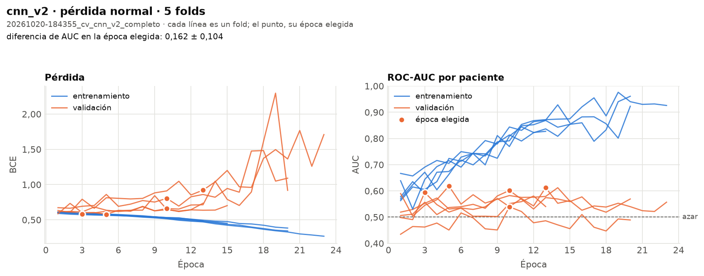

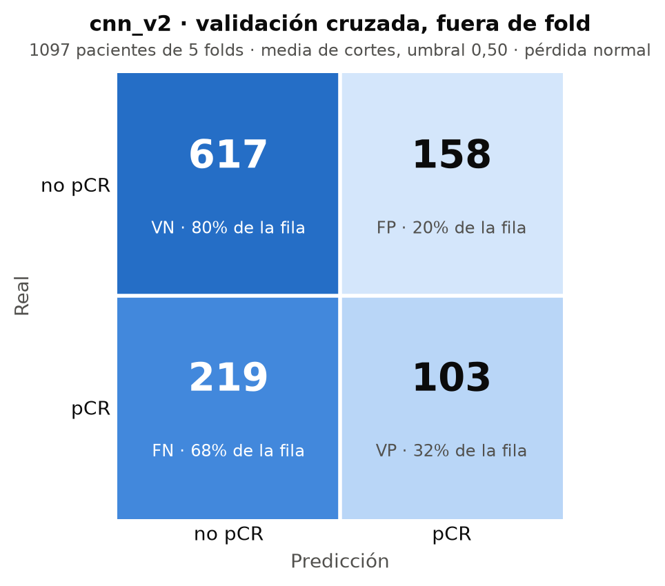

### Resultados

| Fold | Época elegida | AUC val | AUC train | Diferencia |
|---|---|---|---|---|
| 0 | 10 | 0,602 | 0,813 | 0,21 |
| 1 | 13 | 0,613 | 0,872 | 0,26 |
| 2 | 3 | 0,594 | 0,605 | 0,01 |
| 3 | 10 | 0,539 | 0,769 | 0,23 |
| 4 | 5 | 0,619 | 0,715 | 0,10 |
| **Media** | 8,2 | **0,593 ± 0,032** | 0,755 | **0,162** |

- **Fuera de fold** (las 1.097 pacientes, cada una predicha por el modelo que no la vio): AUC
  0,595. Por cohorte: Duke 0,594, I-SPY1 0,494, I-SPY2 0,600.
- **Por subtipo:** HER2+ 0,626, triple negativo 0,622, HR+/HER2− 0,505.
- **¿Delata el hospital?** La puntuación distingue I-SPY2 del resto con AUC 0,581.
- **¿Repite el subtipo?** No: su AUC para HER2+ es 0,491 y para HR+ 0,451.
- Con umbral 0,5, fuera de fold: sensibilidad 0,32, especificidad 0,80.

### Lectura

- **Se cumple la rama «sobreajuste» de lo que esperábamos.** El AUC de entrenamiento sube de 0,6
  a 0,8–0,9 época a época; el de validación se queda entre 0,50 y 0,60 desde la primera época. La
  diferencia media (0,162) pasa el límite de 0,15.
- **El campo receptivo no era el problema:** de cnn_v1 (0,585, un fold) a cnn_v2 (0,593) la
  mejora no llega ni a la desviación entre folds (0,032), con 4 veces más parámetros.
- **Cuidado con el 0,593:** en cada fold se toma la mejor de 13–23 épocas medidas sobre las
  mismas pacientes de validación, así que la cifra está algo inflada. Época a época, el AUC de
  validación ronda 0,53–0,58. El AUC de test, que se mira una vez, será la cifra honesta.

### Decisión

**Descartada** (2026-10-21). Empata con cnn_v3 (a menos de una desviación), pero sobreajusta
(0,162 > 0,15) y el criterio prefiere entonces la que no sobreajusta. Como decía «qué esperamos
ver»: el siguiente paso es regularizar, no crecer.

---

## cnn_v3

**cnn_v2 + aumento de datos.** Origen: **cnn_v2** · Definida el 2026-10-18 · Decidida por Claude
(D15) · Estado: **candidata** (2026-10-21).

### Definición

- **Único cambio respecto a cnn_v2:** la receta de entrenamiento lleva aumento de datos
  geométrico (`entrenamiento = {"aumento": "geometrico"}`, código en `src/data/aumento.py`):
  - volteo horizontal (50 %);
  - giro de hasta ±10°;
  - desplazamiento de hasta ±4 % (unos 10 píxeles);
  - escala entre 0,95 y 1,05.
- La transformación es **idéntica para las tres fases** (se aplica al tensor completo) y solo
  en entrenamiento. No se toca la intensidad: el realce es la señal.
- No hay volteo vertical porque pondría la pared torácica donde no puede estar.
- La red es idéntica a cnn_v2: **97.809 parámetros**. Diagrama:
  [`figuras/cnn_v3.svg`](figuras/cnn_v3.svg).

### Hipótesis

cnn_v1 memorizaba: su pérdida de validación subía desde la época 3 mientras la de entrenamiento
bajaba. Con ~880 pacientes de entrenamiento, la forma más eficaz de evitarlo es que la red no vea
nunca dos veces exactamente la misma imagen. Si cada época ve el corte un poco girado, desplazado
o volteado, no puede memorizar píxeles y tiene que aprender lo que se mantiene: la forma y el
realce del tumor.

Se define ya, aunque cnn_v2 no esté entrenada, porque el plan (D17) entrena las versiones de
noche una tras otra. Tanto si cnn_v2 sobreajusta como si no, cnn_v3 responde a una pregunta útil:
si el aumento ayuda o estorba.

### Qué esperamos ver (antes de entrenar)

- **Si la hipótesis es cierta:**
  - la diferencia entre el AUC de entrenamiento y el de validación es claramente menor que en
    cnn_v2, porque la curva de entrenamiento sube más despacio;
  - el AUC de validación es igual o mejor;
  - la mejor época llega más tarde.
- **Si el AUC de validación baja respecto a cnn_v2 más que la desviación entre folds:** el
  aumento destruye información (por ejemplo, si la orientación importa). Se descarta y se prueba
  otra regularización sin aumento (dropout en la cabeza o weight decay).
- **Si no cambia nada:** la red no estaba memorizando de forma que el aumento lo corrija. El
  límite está en la señal o en cómo entra → cnn_v4 dirá si dar el realce hecho ayuda.

### Ejecuciones

| Ejecución | Pérdida | Tiempo |
|---|---|---|
| `20261020-192927_cv_cnn_v3_completo` | normal | 42 min (30 s/época) |
| `20261020-210342_cv_cnn_v3_completo_ponderada` | ponderada (`pos_weight` ≈ 2,4) | 45 min |

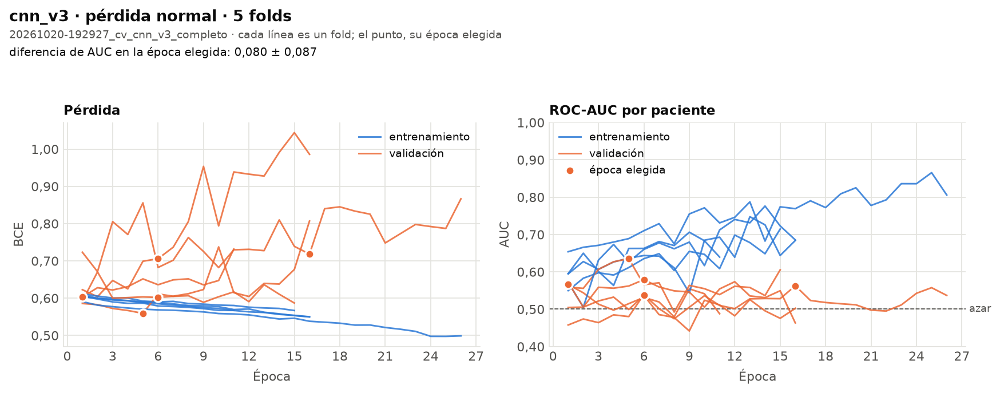

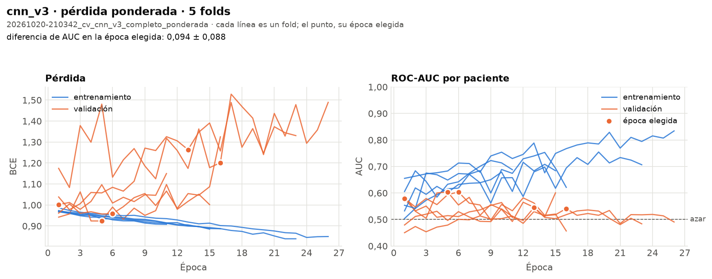

### Resultados

| Fold | Época elegida | AUC val | AUC train | Diferencia |
|---|---|---|---|---|
| 0 | 1 | 0,566 | 0,595 | 0,03 |
| 1 | 6 | 0,537 | 0,644 | 0,11 |
| 2 | 5 | 0,635 | 0,611 | −0,02 |
| 3 | 16 | 0,563 | 0,769 | 0,21 |
| 4 | 6 | 0,579 | 0,660 | 0,08 |
| **Media** | 6,8 | **0,576 ± 0,037** | 0,656 | **0,080** |

- **Fuera de fold:** AUC 0,574. Por cohorte: Duke 0,505, I-SPY1 0,527, I-SPY2 0,579.
- **Por subtipo:** HER2+ 0,611, triple negativo 0,583, HR+/HER2− 0,502.
- **¿Delata el hospital?** La puntuación distingue I-SPY2 del resto con AUC **0,657**.
- **¿Repite el subtipo?** No: AUC 0,478 para HER2+ y 0,449 para HR+.

**Normal frente a ponderada** (rúbrica, punto 6; el enunciado pide compararlas con la versión
elegida):

| | Normal | Ponderada |
|---|---|---|
| AUC val (5 folds) | 0,576 ± 0,037 | 0,574 ± 0,030 |
| AUC fuera de fold | 0,574 | 0,543 |
| Diferencia train − val | 0,080 | 0,094 |
| Sensibilidad con umbral 0,5 (fuera de fold) | 0,02 | 0,56 |
| Especificidad con umbral 0,5 (fuera de fold) | 0,99 | 0,53 |

### Lectura

Frente a lo que esperábamos:
- **La diferencia train − val baja a la mitad (0,162 → 0,080): se cumple.** El aumento de datos
  frena la memorización.
- **El AUC de validación, igual** (0,576 frente a 0,593, dentro de una desviación): se cumple la
  parte «igual o mejor», pero no mejora.
- **La mejor época no llega más tarde** (6,8 frente a 8,2): no se cumple. La red no aprende más
  despacio y mejor; aprende lo mismo de poco, y luego nada.
- **Lo nuevo y más importante:** la puntuación reconoce I-SPY2 (0,657), que tiene más pCR (32 %
  frente a 21–25 %) y más realce (auditoría). Dentro de Duke y de I-SPY1 la red está casi al azar
  (0,51–0,53). **Parte del AUC viene de reconocer el hospital, no el tumor.** Responde a la
  pregunta de la guía «¿la red aprende biología tumoral o diferencias entre cohortes?»: en parte,
  cohortes.
- **Su señal no es el subtipo** (AUC ~0,45–0,48 para HER2 y HR) y está donde el subtipo no llega
  del todo: HER2+ y triple negativo (~0,58–0,61). En HR+/HER2−, nada.
- **Pérdida ponderada:** igual que con cnn_v1, mueve el punto de corte (la sensibilidad con
  umbral 0,5 pasa de 0,02 a 0,56) pero no la capacidad de ordenar (el AUC no sube). Como el
  umbral se elige después con su criterio, la normal es suficiente.

### Decisión

**Candidata** (2026-10-21): la mejor según el criterio (empata con cnn_v2 y no sobreajusta), con
pérdida normal. Es el punto de partida de la segunda ronda: cnn_v5 a cnn_v8 cambian una idea cada
una sobre ella.

---

## cnn_v4

**cnn_v3 + realce explícito en la entrada.** Origen: **cnn_v3** · Definida el 2026-10-18 ·
Decidida por Claude (D15) · Estado: **descartada** (2026-10-21).

### Definición

- **Único cambio respecto a cnn_v3:** `entrada = "fases+realce"`. La red recibe lo mismo (las 3
  fases en [0, 1]) y calcula **dentro** dos canales más, que pasan al primer bloque:
  - EARLY − PRE: el realce, donde entra el contraste;
  - LATE − EARLY: el lavado, negativo si el contraste se va.
- El primer bloque pasa de 432 a 720 pesos: **98.097 parámetros** en total. Diagrama:
  [`figuras/cnn_v4.svg`](figuras/cnn_v4.svg).
- Se calcula dentro de la red a propósito: la app le pasa las mismas 3 fases que el
  entrenamiento, así que no puede haber un preprocesado distinto entre los dos (el fallo que el
  profesor busca en la defensa).
- Mantiene el aumento de cnn_v3. El aumento se aplica a las fases antes de la resta, así que el
  realce sigue alineado.

### Hipótesis

La señal del problema está en la **cinética del contraste**: cuánto se ilumina el tejido y si
luego se lava (guía B2; el *washout* aparece en el 17 % de las pacientes y se asocia a lesiones
sospechosas). Una CNN que empieza con filtros al azar tiene que descubrir por sí sola que la
resta entre canales es lo importante, y con pocos datos puede no lograrlo. Dársela hecha es
conocimiento del dominio, no un modelo preentrenado, así que está permitido.

### Qué esperamos ver (antes de entrenar)

- **Si la hipótesis es cierta:** el AUC de validación sube respecto a cnn_v3 más que la
  desviación entre folds, y la mejor época llega antes, porque la señal es más fácil de
  encontrar.
- **Si queda igual:** la red ya aprendía la resta por su cuenta. Por el criterio de comparación
  se queda la más simple, cnn_v3.
- **Si baja:** los canales de diferencia añaden ruido (por ejemplo, realces negativos en cortes
  con las fases algo desalineadas). Se descarta.

### Ejecuciones

| Ejecución | Pérdida | Tiempo |
|---|---|---|
| `20261020-201130_cv_cnn_v4_completo` | normal | 52 min (32 s/época) |

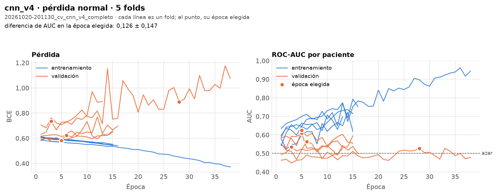

### Resultados

| Fold | Época elegida | AUC val | AUC train | Diferencia |
|---|---|---|---|---|
| 0 | 6 | 0,564 | 0,684 | 0,12 |
| 1 | 3 | 0,534 | 0,645 | 0,11 |
| 2 | 5 | 0,609 | 0,600 | −0,01 |
| 3 | 28 | 0,528 | 0,897 | 0,37 |
| 4 | 5 | 0,626 | 0,662 | 0,04 |
| **Media** | 9,4 | **0,572 ± 0,044** | 0,698 | **0,126** |

- **Fuera de fold:** AUC 0,547. Por cohorte: Duke 0,512, I-SPY1 0,543, I-SPY2 0,546.
- **Por subtipo:** HER2+ 0,583, triple negativo 0,558, HR+/HER2− 0,504.
- **¿Delata el hospital?** AUC 0,606 para I-SPY2.

### Lectura

- **Se cumple la rama «si queda igual»:** 0,572 frente a 0,576 de cnn_v3. Darle la resta hecha no
  ayuda: la primera convolución ya puede aprender restas entre canales, y lo que falta no es eso.
- El fold 3 entrenó 38 épocas y memorizó mucho (diferencia 0,37) sin mejorar en validación: con
  dos canales más, la red tiene más con qué memorizar.

### Decisión

**Descartada** (2026-10-21). Empata con cnn_v3 pero tiene más parámetros; por el criterio se queda
la más simple, cnn_v3.

---

## cnn_v5

**Intensidad relativa a la propia paciente.** Origen: **cnn_v3** · Definida el 2026-10-21 ·
Decidida por Claude (D15, D28) · Estado: **descartada** (2026-10-21).

### Definición

- **Único cambio respecto a cnn_v3:** `normalizacion = "pre"`. Dentro de la red, las tres fases de
  cada corte se dividen entre la **intensidad media del PRE en su tejido** (píxeles con PRE > 0,1,
  la misma definición que la auditoría). Tras eso el tejido vale ~1 en PRE, y un 1,4 en EARLY
  significa «realza un 40 %».
- Las tres fases se dividen entre el mismo número: el realce relativo se conserva.
- Se calcula dentro de la red (`normalizar_por_pre` en `src/models/cnn.py`), así que la app recibe
  lo mismo que el entrenamiento.
- **97.809 parámetros**, los mismos que cnn_v3. Diagrama: [`figuras/cnn_v5.svg`](figuras/cnn_v5.svg).

### Hipótesis

Parte del AUC de cnn_v3 viene de reconocer el hospital: su puntuación distingue I-SPY2 del resto
con AUC 0,657, y dentro de Duke e I-SPY1 está casi al azar. Cada escáner tiene su escala de
intensidad y el dataset no las armoniza (Fridman et al.; auditoría: realce medio 0,149 en I-SPY2
frente a ~0,11 en Duke e I-SPY1). Si la red ve la intensidad relativa a la propia paciente, pierde
ese atajo y tiene que fijarse en el tejido. Es la idea del realce relativo que se usa en clínica.

### Qué esperamos ver (antes de entrenar)

- **Si la hipótesis es cierta:**
  - la puntuación delata menos el hospital: «¿delata el hospital?» para I-SPY2 baja de 0,657
    hacia 0,5–0,58;
  - el AUC dentro de Duke y de I-SPY1 sube por encima de 0,53;
  - el AUC medio sube, o al menos no baja más de una desviación.
- **Si el AUC medio baja pero el de dentro de cada hospital sube:** el AUC anterior estaba
  inflado por el hospital. Es la versión más honesta y la preferimos; se cuenta en el informe.
- **Si no cambia nada:** el atajo no pasa por la escala de intensidad (podría ser la anatomía o el
  encuadre de cada centro).

### Ejecuciones

| Ejecución | Pérdida | Tiempo |
|---|---|---|
| `20261021-135616_cv_cnn_v5_completo` | normal | 47 min (30 s/época) |

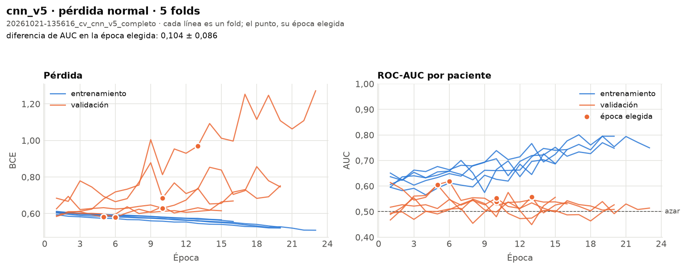

### Resultados

| Fold | Época elegida | AUC val | AUC train | Diferencia |
|---|---|---|---|---|
| 0 | 10 | 0,539 | 0,707 | 0,17 |
| 1 | 13 | 0,557 | 0,696 | 0,14 |
| 2 | 5 | 0,605 | 0,592 | −0,01 |
| 3 | 10 | 0,553 | 0,739 | 0,19 |
| 4 | 6 | 0,619 | 0,658 | 0,04 |
| **Media** | 8,8 | **0,574 ± 0,035** | 0,678 | **0,104** |

- **Fuera de fold:** AUC 0,566. Por cohorte: Duke 0,519, I-SPY1 0,418, I-SPY2 0,586.
- **¿Delata el hospital?** Duke 0,41 · I-SPY1 0,41 · I-SPY2 0,61 (cnn_v3: 0,42 · 0,28 · 0,66).
- **Por subtipo:** HER2+ 0,59, triple negativo 0,59, HR+/HER2− 0,51. No repite el subtipo (AUC 0,48
  para HER2+ y 0,47 para HR+).
- **Frente a cnn_v3 en las mismas pacientes:** −0,009 (IC 95 % de −0,046 a +0,026).

### Lectura

Frente a lo que esperábamos:
- **La señal del hospital baja poco:** I-SPY2 pasa de 0,66 a 0,61 (esperábamos 0,50–0,58). I-SPY1 se
  acerca a 0,5 (de 0,28 a 0,41), pero sigue lejos.
- **El AUC dentro de Duke e I-SPY1 no sube** (0,52 y 0,42): no se cumple.
- **El AUC medio, igual** (0,574 frente a 0,576).
- **Es el caso «si no cambia nada»:** el atajo no pasa (solo) por la escala de intensidad. La ficha
  apuntaba a la anatomía o el encuadre, y el mosaico de la auditoría lo confirmó en parte: cada hospital
  orienta la mama a su manera (D29, cnn_v10).

### Decisión

**Descartada** (2026-10-21): no mejora y tampoco quita el atajo del hospital. Por el criterio empata
con cnn_v3, con los mismos parámetros, y gana la más antigua.

---

## cnn_v6

**Mirar dónde está el tumor.** Origen: **cnn_v3** · Definida el 2026-10-21 · Decidida por Claude
(D15, D28) · Estado: **descartada** (2026-10-21).

### Definición

- **Único cambio respecto a cnn_v3:** `resumen = "atencion"`. El último paso ya no es la media de
  las 16×16 posiciones del mapa final, sino una **media ponderada con pesos que aprende la red**
  (pooling por atención, Ilse et al. 2018):
  `a_k = softmax(w · tanh(V · h_k))`, `resumen = Σ a_k · h_k`, con V de 128→32 y w de 32→1.
- Los pesos suman 1. Si fueran todos iguales sería la media global de antes: la atención la
  generaliza.
- **101.970 parámetros** (4.161 más que cnn_v3). Diagrama: [`figuras/cnn_v6.svg`](figuras/cnn_v6.svg).
- Los pesos del último corte se guardan (`ultimos_pesos`): se pueden dibujar encima de la imagen
  para ver dónde mira la red.

### Hipótesis

En los cortes, el tumor ocupa una zona pequeña y realzan también el corazón y la pared torácica.
La media global da el mismo peso (1/256) a cada posición, así que las pocas casillas del tumor se
diluyen entre el fondo. La auditoría lo apoya: el realce medio de todo el tejido solo da AUC 0,54.
Con atención, la red puede dar más peso a donde está lo que importa.

### Qué esperamos ver (antes de entrenar)

- **Si la hipótesis es cierta:** el AUC medio sube respecto a cnn_v3 más que la desviación entre
  folds (~0,035), sobre todo dentro de HER2+ y triple negativo, donde ya hay algo de señal.
- **Si no cambia:** con solo la etiqueta de la paciente y ~880 pacientes, la red no consigue
  encontrar el tumor por sí sola. Para ayudarla habría que decirle dónde está al entrenar (las
  coordenadas del tumor están en `patients.csv`), algo que habría que consultar con el profesor,
  porque pide que esas variables solo se usen para comparar.

### Ejecuciones

| Ejecución | Pérdida | Tiempo |
|---|---|---|
| `20261021-144306_cv_cnn_v6_completo` | normal | 40 min (30 s/época) |

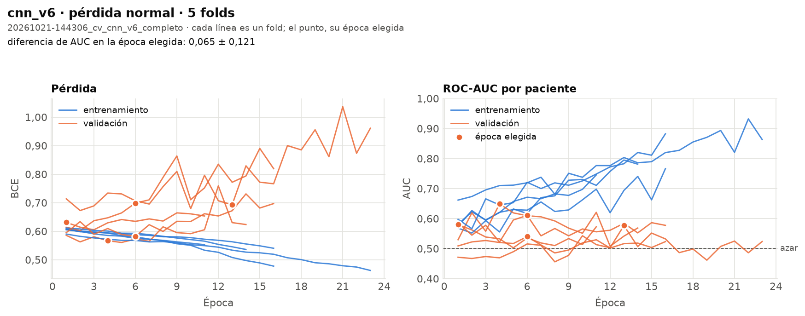

### Resultados

| Fold | Época elegida | AUC val | AUC train | Diferencia |
|---|---|---|---|---|
| 0 | 1 | 0,580 | 0,574 | −0,01 |
| 1 | 6 | 0,540 | 0,628 | 0,09 |
| 2 | 4 | 0,649 | 0,555 | −0,09 |
| 3 | 13 | 0,577 | 0,803 | 0,23 |
| 4 | 6 | 0,611 | 0,721 | 0,11 |
| **Media** | 6,0 | **0,591 ± 0,041** | 0,656 | **0,065** |

- **Fuera de fold:** AUC 0,569 (más bajo que la media de los folds: cada fold puntúa en una escala
  algo distinta). Por cohorte: Duke 0,544, I-SPY1 0,587, I-SPY2 0,562.
- **¿Delata el hospital?** Duke 0,45 · I-SPY1 0,32 · I-SPY2 0,61.
- **Por subtipo:** HER2+ 0,62, triple negativo 0,56, HR+/HER2− 0,54. No repite el subtipo (0,49 y
  0,48).
- **Frente a cnn_v3 en las mismas pacientes:** −0,005 (IC 95 % de −0,039 a +0,027).

### Lectura

Frente a lo que esperábamos:
- **El AUC medio no sube más que la desviación** (0,591 frente a 0,576, con ±0,04): no se cumple.
  Fuera de fold, incluso queda igual (0,569 frente a 0,574).
- **HER2+ sube un poco** (0,61 → 0,62); triple negativo baja (0,58 → 0,56). Nada claro.
- **Es el caso «si no cambia»:** con una sola etiqueta por paciente y ~880 pacientes, la atención no
  encuentra el tumor por sí sola. Su puntuación sigue sin relación con el tamaño del tumor (Spearman
  −0,10). La forma de ayudarla es decirle dónde está al entrenar: cnn_v9, pendiente del profesor
  (D29).

### Decisión

**Descartada** (2026-10-21): empata con cnn_v3 y tiene 4.161 parámetros más, así que por el criterio
gana cnn_v3. La atención se queda como base de cnn_v9 si el profesor permite usar la caja del tumor.

---

## cnn_v7

**Regularización: dropout y weight decay.** Origen: **cnn_v3** · Definida el 2026-10-21 ·
Decidida por Claude (D15, D28) · Estado: **descartada** (2026-10-21).

### Definición

- **Cambio respecto a cnn_v3** (una idea, «regularizar», con sus dos piezas habituales):
  - **dropout 0,3** antes de la capa final: en cada paso se apaga al azar el 30 % de las 128
    entradas de la última capa;
  - **AdamW con weight decay 0,05** en lugar de Adam sin weight decay: en cada paso los pesos se
    encogen un poco hacia 0 (solo los de convoluciones y lineales, no los sesgos ni BatchNorm).
    0,05 es un valor habitual con AdamW (0,01–0,05); con lr 1e-3, unas 5.000 iteraciones encogen
    un peso que no se use en torno a un 20 %.
- **97.809 parámetros**, los mismos que cnn_v3. Diagrama: [`figuras/cnn_v7.svg`](figuras/cnn_v7.svg).

### Hipótesis

La red sigue memorizando: aun con aumento de datos, el fold 3 de cnn_v3 llega a 0,77 en
entrenamiento con 0,56 en validación. El dropout impide que la decisión dependa de unas pocas
neuronas concretas; el weight decay impide pesos grandes, que son los que permiten memorizar
detalles de pacientes concretas. Son las dos herramientas estándar y la red no tenía ninguna.

### Qué esperamos ver (antes de entrenar)

- **Si la hipótesis es cierta:** la diferencia train − val baja de 0,080, la mejor época llega más
  tarde y el AUC de validación sube o se mantiene.
- **Si la diferencia baja pero el AUC no sube:** igual que con el aumento de datos, frenar la
  memoria no basta; el límite está en la señal que la red encuentra, no en cuánto memoriza.

### Ejecuciones

| Ejecución | Pérdida | Tiempo |
|---|---|---|
| `20261021-152323_cv_cnn_v7_completo` | normal | 53 min (30 s/época) |

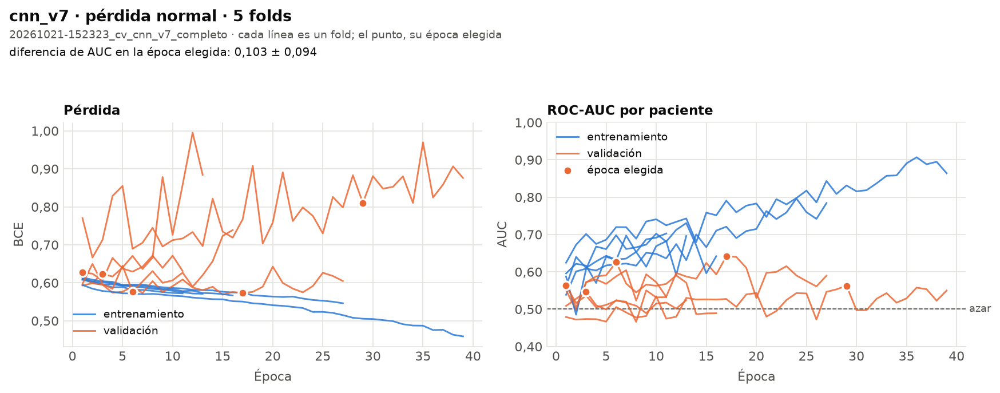

### Resultados

| Fold | Época elegida | AUC val | AUC train | Diferencia |
|---|---|---|---|---|
| 0 | 1 | 0,563 | 0,596 | 0,03 |
| 1 | 3 | 0,547 | 0,611 | 0,06 |
| 2 | 17 | 0,642 | 0,721 | 0,08 |
| 3 | 29 | 0,563 | 0,831 | 0,27 |
| 4 | 6 | 0,626 | 0,698 | 0,07 |
| **Media** | 11,2 | **0,588 ± 0,042** | 0,691 | **0,103** |

- **Fuera de fold:** AUC 0,557. Por cohorte: Duke 0,529, I-SPY1 0,568, I-SPY2 0,551.
- **¿Delata el hospital?** Duke 0,42 · I-SPY1 0,40 · I-SPY2 0,61.
- **Por subtipo:** HER2+ 0,57, triple negativo 0,57, HR+/HER2− 0,55. No repite el subtipo (0,48 y
  0,48).
- **Frente a cnn_v3 en las mismas pacientes:** −0,017 (IC 95 % de −0,053 a +0,019).

### Lectura

Frente a lo que esperábamos:
- **La diferencia train − val no baja: sube** (0,080 → 0,103). El fold 3 llega a la época 29 con 0,83
  en entrenamiento.
- **La mejor época llega más tarde** (11,2 frente a 6,8): se cumple, pero lo que gana con más épocas es
  memoria, no validación.
- **El AUC, igual** (0,588 frente a 0,576).
- **Conclusión:** frenar la memoria no basta. Ni el aumento de datos (cnn_v3) ni el dropout y el
  weight decay hacen que la red encuentre más señal. El límite está en lo que la red encuentra, no en
  cuánto memoriza.

### Decisión

**Descartada** (2026-10-21): no mejora el AUC ni la diferencia train − val. Por el criterio empata con
cnn_v3, con los mismos parámetros, y gana la más antigua.

---

## cnn_v8

**Las tres ideas juntas.** Origen: **cnn_v3** · Definida el 2026-10-21 · Decidida por Claude
(D15, D28) · Estado: **descartada** (2026-10-21).

### Definición

- **Cambios respecto a cnn_v3:** los de cnn_v5, cnn_v6 y cnn_v7 a la vez: intensidad relativa al
  PRE, pooling por atención, dropout 0,3 y AdamW con weight decay 0,05.
- **101.970 parámetros.** Diagrama: [`figuras/cnn_v8.svg`](figuras/cnn_v8.svg).
- No sigue la regla de «una idea por versión» a propósito: se entrena a la vez que cnn_v5–v7, y
  ellas dicen qué aporta cada pieza. Así una sola noche de GPU contesta las dos preguntas (qué
  ayuda por separado y si suman), en vez de dos noches.

### Hipótesis

Las tres ideas atacan problemas distintos (el hospital, la dilución del tumor y la memorización),
así que, si cada una ayuda algo, juntas deberían sumar.

### Qué esperamos ver (antes de entrenar)

- **Si suman:** cnn_v8 queda por encima de la mejor de cnn_v5–v7.
- **Si queda por debajo de alguna:** alguna pieza estorba a otra; la ganadora será la versión
  suelta que mejor salga, y la combinación se rehace sin la pieza que sobra.

### Ejecuciones

| Ejecución | Pérdida | Tiempo |
|---|---|---|
| `20261021-161603_cv_cnn_v8_completo` | normal | 17 min: solo el fold 0; se cayó en el fold 1 porque la tarjeta gráfica se quedó colgada (R5) |
| `20261021-192232_cv_cnn_v8_completo` | normal | 73 min (30 s/época), tras reiniciar el PC |

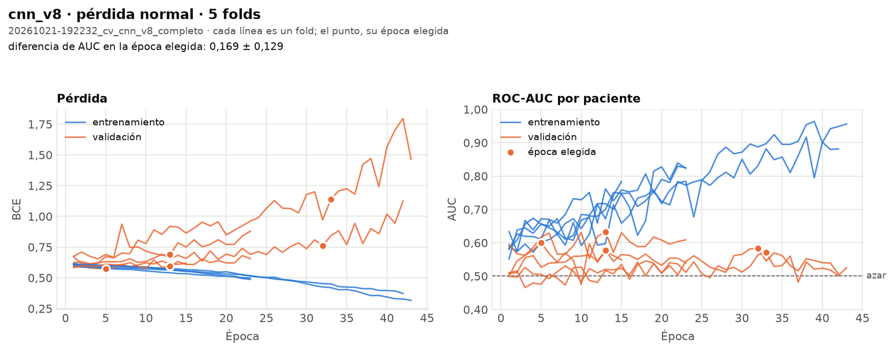

### Resultados

| Fold | Época elegida | AUC val | AUC train | Diferencia |
|---|---|---|---|---|
| 0 | 32 | 0,583 | 0,831 | 0,25 |
| 1 | 33 | 0,571 | 0,897 | 0,33 |
| 2 | 5 | 0,600 | 0,602 | 0,00 |
| 3 | 13 | 0,577 | 0,762 | 0,18 |
| 4 | 13 | 0,633 | 0,717 | 0,08 |
| **Media** | 19,2 | **0,593 ± 0,025** | 0,762 | **0,169** |

- **Fuera de fold:** AUC 0,587. Por cohorte: Duke 0,533, I-SPY1 0,473, I-SPY2 0,603.
- **¿Delata el hospital?** Duke 0,44 · I-SPY1 0,39 · I-SPY2 0,59.
- **Por subtipo:** HER2+ 0,62, triple negativo 0,60, HR+/HER2− 0,53. No repite el subtipo (0,51 y
  0,47).
- **Frente a cnn_v3 en las mismas pacientes:** +0,013 (IC 95 % de −0,029 a +0,053).
- **El mismo fold 0, entrenado dos veces** con la misma versión y la misma semilla, dio 0,558 (época 23)
  y 0,583 (época 32). La tarjeta no es determinista del todo: solo el azar del entrenamiento mueve el
  AUC de un fold unas 0,025.

### Lectura

Frente a lo que esperábamos:
- **No suman:** 0,593 apenas supera a la mejor de cnn_v5–v7 (cnn_v6, 0,591) y está dentro de una
  desviación de cnn_v3.
- **Sobreajusta más que todas** (0,169): con la atención tiene más capacidad, y en los folds 0 y 1
  elige épocas por encima de la 30, con 0,83–0,90 en entrenamiento. El dropout y el weight decay no lo
  compensan.
- **Delata algo menos el hospital** (I-SPY1 0,39, I-SPY2 0,59), pero lo sigue haciendo.
- **Lo que confirma la segunda ronda:** ninguna pieza de arquitectura o de regularización cambia el
  resultado. Las versiones ni siquiera coinciden entre sí al ordenar a las pacientes (Spearman
  0,33–0,62 entre cnn_v3, v5, v6, v7 y v8): buena parte de lo que aprende cada una es ruido (R5).

### Decisión

**Descartada** (2026-10-21): empata con cnn_v3 pero sobreajusta (0,169 > 0,15).

---

## cnn_v10

**Quitar la pista de la orientación.** Origen: **cnn_v3** · Definida el 2026-10-21 · Decidida por
Claude (D15, D29) · Estado: **descartada** (2026-10-21).

cnn_v9 queda reservada para la atención guiada por la caja del tumor: solo se definirá si el
profesor permite usar las coordenadas del tumor al entrenar (D29).

### Definición

- **Único cambio respecto a cnn_v3:** el aumento pasa de `geometrico` a `geometrico+giros90`.
  - Antes del aumento de cnn_v3, cada corte se gira 0°, 90°, 180° o 270° al azar, igual en las tres
    fases.
  - Con el volteo horizontal que ya había, salen las 8 orientaciones posibles del cuadrado con la
    misma probabilidad.
- Solo en entrenamiento: validación, test y app ven la imagen tal cual.
- La red es idéntica a la de cnn_v3: **97.809 parámetros**. Diagrama:
  [`figuras/cnn_v10.svg`](figuras/cnn_v10.svg).
- **Deja de valer la regla de cnn_v3 de no voltear en vertical.** Suponía que la pared torácica
  está siempre en el mismo lado, y en este dataset no es así (figura de la hipótesis).

### Hipótesis

**Cada hospital orienta la mama a su manera.** Se ve en el mosaico de la auditoría
([`orientacion.png`](resultados/1_auditoria/orientacion.png), 10 pacientes al azar por cohorte):
- en **I-SPY1**, la mama apunta **hacia abajo** en las 10;
- en **I-SPY2 y Duke**, apunta a la izquierda o a la derecha;
- en Duke y en alguna de I-SPY2 se ven el corazón y los pulmones (otro plano de corte).

**La red de cnn_v3 lo aprovecha.** Su puntuación distingue I-SPY1 del resto con AUC **0,28**, es
decir, le da puntuaciones más bajas que al resto. Si la puntuación solo reflejara la pCR (I-SPY1 tiene
un 25 % frente al 29 % global), saldría 0,50 ± 0,03. La orientación no dice nada del tumor, solo del
hospital.

**cnn_v5 encaja con esto.** Normalizar la intensidad apenas bajó la señal del hospital (I-SPY2:
0,66 → 0,61). Su ficha preveía que, en ese caso, el atajo podría ser «la anatomía o el encuadre de
cada centro». El mosaico dice que, al menos en parte, es el encuadre.

**Qué debería pasar.** Si la orientación deja de servir de pista, la red no puede usarla y tiene que
apoyarse en lo que sí cambia entre pacientes.

### Qué esperamos ver (antes de entrenar)

- **Si la hipótesis es cierta:**
  - «¿delata el hospital?» para I-SPY1 sube de 0,28 hacia 0,45–0,50;
  - el AUC dentro de Duke e I-SPY1 no baja;
  - el AUC medio se mantiene o sube.
- **Si el AUC medio baja un poco pero deja de reconocer I-SPY1:** parte del AUC de cnn_v3 venía de
  reconocer el hospital (I-SPY1 tiene menos pCR que la media). Es la versión más honesta y se
  cuenta en el informe (rúbrica, punto 9).
  - Por el criterio (D16), si empata con cnn_v3, sigue ganando cnn_v3: tienen los mismos
    parámetros y cnn_v3 es más antigua.
  - El criterio está fijado desde el 2026-10-18 y no se cambia después de ver resultados.
- **Si sigue reconociendo I-SPY1:** la red lo distingue por otra cosa, como el plano de corte o la
  anatomía que se ve. Eso no se quita girando, solo guiando la atención al tumor (cnn_v9).

### Ejecuciones

| Ejecución | Pérdida | Tiempo |
|---|---|---|
| `20261021-203548_cv_cnn_v10_completo` | normal | 49 min (30 s/época) |

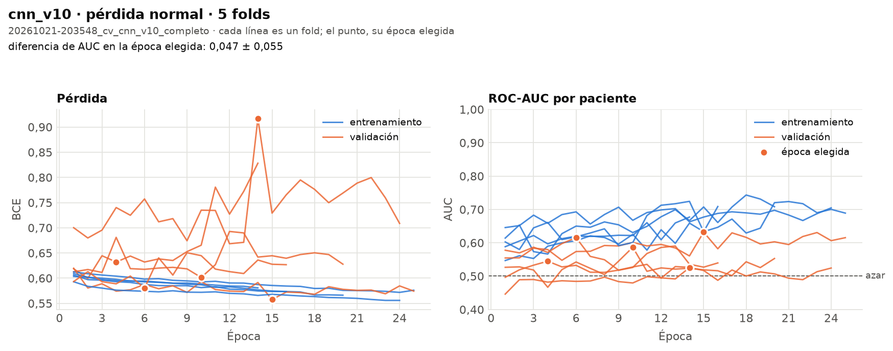

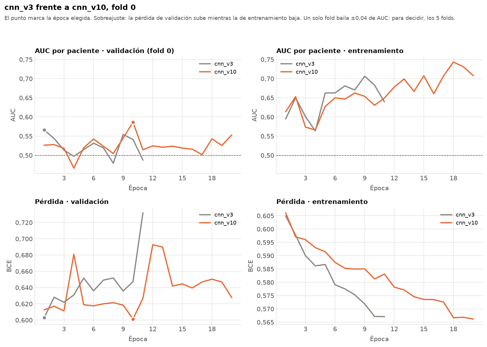

### Resultados

| Fold | Época elegida | AUC val | AUC train | Diferencia |
|---|---|---|---|---|
| 0 | 10 | 0,587 | 0,631 | 0,04 |
| 1 | 4 | 0,545 | 0,597 | 0,05 |
| 2 | 15 | 0,632 | 0,633 | 0,00 |
| 3 | 14 | 0,526 | 0,663 | 0,14 |
| 4 | 6 | 0,616 | 0,618 | 0,00 |
| **Media** | 9,8 | **0,581 ± 0,045** | 0,628 | **0,047** |

- **Fuera de fold:** AUC 0,552. Por cohorte: Duke 0,570, I-SPY1 0,641, I-SPY2 0,528.
- **¿Delata el hospital?** Duke 0,43 · I-SPY1 **0,42** · I-SPY2 0,59 (cnn_v3: 0,42 · **0,28** · 0,66).
- **Por subtipo:** HER2+ 0,61, triple negativo 0,54, HR+/HER2− 0,50. No repite el subtipo (0,48 y
  0,47).
- **Frente a cnn_v3 en las mismas pacientes:** −0,022 (IC 95 % de −0,066 a +0,020). Coinciden poco al
  ordenar a las pacientes (Spearman 0,38).

### Lectura

Frente a lo que esperábamos:
- **Reconoce mucho menos I-SPY1** (0,28 → 0,42, cerca de 0,5): se cumple. La orientación era una de
  las pistas del hospital, y los giros se la quitan. Lo que queda (I-SPY2 0,59) viene de otras
  diferencias, como el plano de corte o el tamaño de los tumores.
- **El AUC dentro de Duke e I-SPY1 sube** (0,51 → 0,57 y 0,53 → 0,64): se cumple. Con 104 pacientes,
  lo de I-SPY1 tiene mucho margen de error (unas ±0,11).
- **El AUC medio, igual** (0,581 frente a 0,576), pero **dentro de I-SPY2 baja** (0,58 → 0,53), y como
  I-SPY2 es el 71 % de las pacientes, el AUC fuera de fold baja (0,574 → 0,552). Es el caso que
  preveíamos: parte del AUC de cnn_v3 venía de reconocer el hospital.
- **Es la versión que menos memoriza** (diferencia 0,047, frente a 0,080 de cnn_v3): con las 8
  orientaciones le cuesta más aprenderse las imágenes. En las curvas, el AUC de entrenamiento se queda
  en 0,60–0,70 y no se dispara como en cnn_v8.
- **No encuentra más tumor:** su puntuación sigue sin relación con el tamaño (Spearman −0,05). Quitar
  un atajo no le enseña dónde mirar.

### Decisión

**Descartada** (2026-10-21) por el criterio fijado antes de entrenar: empata con cnn_v3, tiene los
mismos parámetros y gana la más antigua. Va al informe como prueba del sesgo entre hospitales y de
cómo se corrige en parte (rúbrica, punto 9).

---

## cnn_v11

**Mirar solo el tumor (recorte con su caja).** Origen: **cnn_v3** · Definida el 2026-10-21 ·
Propuesta por Judith, implementada por Claude (D15, D33) · Estado: **por entrenar**.

**No es desplegable.** La app y la validación privada del profesor no tienen la caja del tumor, así que
cnn_v11 no puede ser el modelo final: el criterio no la elige y `cerrar_modelo` se niega a cerrarla.
Sirve para medir **cuánto se gana centrándose en el tumor**.

### Definición

- **Único cambio respecto a cnn_v3:** en vez del corte entero (256×256), la red ve un cuadrado de
  **128×128 píxeles centrado en la caja del tumor** (`sraw`, `eraw`, `scol`, `ecol` de
  `patients.csv`, pasadas a píxeles del PNG con 256 / `n_xy`).
- **No cambia la escala:** se recorta, no se amplía, porque el tamaño del tumor también es información
  (R5). 128 px cubren la caja del ~90 % de los tumores; en los más grandes queda fuera el borde.
- Las tres fases se recortan con la misma ventana, y el aumento se aplica después del recorte.
- Mismas capas que cnn_v3: **97.809 parámetros**, con un mapa final de 8×8 en vez de 16×16. Diagrama:
  [`figuras/cnn_v11.svg`](figuras/cnn_v11.svg). Cada época tarda unas 4 veces menos.
- **Antes de entrenar,** `python -m src.data.recorte` comprueba que las cajas caen sobre el tumor: el
  realce dentro de la caja tiene que ser claramente mayor que en el resto del tejido. Dibuja algunas
  en `docs/resultados/1_auditoria/cajas.png`.

### Hipótesis

La red no encuentra el tumor por sí sola (R5): ocupa un 3–8 % del corte, y el corazón y la pared
torácica realzan tanto o más. Casi todos los trabajos de pCR con buenos resultados le dan a la red una
región centrada en el tumor, con algo de tejido alrededor (Braman et al. 2017 y 2020). Si la red solo
ve el tumor y su entorno, no puede distraerse con el resto ni usar pistas del hospital que están fuera
del tumor.

### Qué esperamos ver (antes de entrenar)

- **Si la hipótesis es cierta:**
  - el AUC medio supera claramente al de cnn_v3, por encima de 0,61 (0,576 + una desviación);
  - el AUC sube dentro de cada hospital;
  - la puntuación se relaciona con el tamaño del tumor y con el subtipo (HER2+ y triple negativo).

  Entonces merece la pena conseguir el recorte sin la caja: que la red aprenda a localizar el tumor
  (cnn_v9) o que en la app el usuario marque el tumor. Las dos cosas hay que preguntárselas al profesor
  (duda 7).
- **Si no mejora:** el problema no era dónde mira la red, sino la poca información que tiene un corte de
  antes del tratamiento para predecir la pCR, como en la bibliografía (solo imagen: ~0,55–0,65). Se
  cierra con cnn_v3 y lo honesto es contarlo, junto con la comparación CNN + médico.

### Ejecuciones

Pendientes: paso 9 del plan (D33).

### Resultados

Pendientes.

### Lectura

Pendiente.

### Decisión

Pendiente.

---

## Modelo final

Pendiente de los resultados del plan. El **procedimiento** ya está decidido (D21 del registro;
explicado en [`COMO_SE_HIZO.md`](COMO_SE_HIZO.md)) y lo hace `python -m src.evaluation.cerrar_modelo`:
- **Versión:** la que gane con el criterio de comparación, con la pérdida (normal o ponderada) que
  dé más AUC medio en sus 5 folds.
- **Pesos:** el conjunto de los 5 modelos de su validación cruzada; se promedian sus logits.
- **Agregación:** media de los cortes.
- **Umbral:** el de mayor sensibilidad con especificidad ≥ 0,80, elegido con las predicciones
  fuera de fold.
- **Probabilidad calibrada** con Platt, ajustado también fuera de fold.

Cuando esté, aquí se anotará:
- qué versión se elige y por qué, con la comparación de la tabla de resumen;
- la configuración de entrenamiento;
- cómo se obtienen los pesos finales;
- la agregación y el umbral elegidos con las predicciones fuera de fold, con su criterio clínico;
- la ruta en `models/final/` y su checksum, que es el que mostrará la app.

---

## Plantilla para una versión nueva

Copiar desde aquí, sustituir `cnn_vN` y mantener el título de nivel 2 exactamente como el nombre
de la versión: los tests lo buscan y las tablas enlazan a él.

```markdown
## cnn_vN

**Nombre corto.** Origen: **cnn_vX** · Definida el AAAA-MM-DD · Decidida por Judith ·
Estado: **por entrenar**.

### Definición
- Único cambio respecto a cnn_vX: ...
- Tamaños: ...
- Parámetros: ... (python -m src.models.comprobar cnn_vN)
- Diagrama: figuras/cnn_vN.svg (python -m src.models.dibujar cnn_vN)

### Hipótesis
Qué problema de la versión de origen intenta resolver y por qué este cambio debería ayudar.

### Qué esperamos ver (antes de entrenar)
- Si la hipótesis es cierta: ...
- Si no lo es: ... y qué haríamos entonces.

### Ejecuciones
Nombres de las carpetas de runs/ (están en la tabla de ejecuciones) y gráficas copiadas
con python -m src.models.historial --figuras runs/<ejecución>.

### Resultados
Cifras clave: AUC val (media ± desviación), AUC train, diferencia, sensibilidad y
especificidad, normal frente a ponderada.

### Lectura
Qué significan los resultados frente a lo que esperábamos.

### Decisión
Descartada, candidata o final, con fecha y motivo (Judith).

### Qué aprendimos y qué lleva a la siguiente
```
