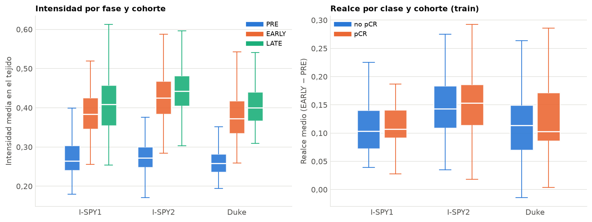
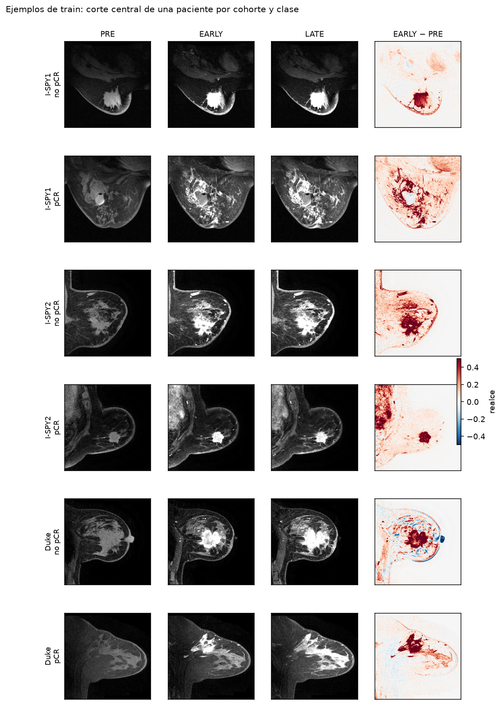
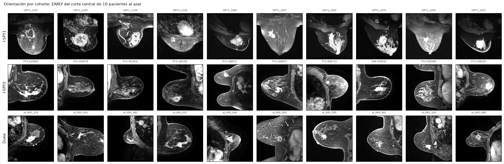

# Auditoría de los datos

Generado automáticamente por `python -m src.data.auditoria` el 2026-10-21 21:37. No se edita a mano:
se vuelve a generar. La explicación de por qué se mira cada cosa está en el código y en
[`COMO_SE_HIZO.md`](../../COMO_SE_HIZO.md).

## 1. Recuentos

| Conjunto | Pacientes | Cortes | Pacientes con pCR |
|---|---|---|---|
| test | 176 | 1758 | 53 (30,1 %) |
| train | 1097 | 10945 | 322 (29,4 %) |

Decir siempre «no pCR» acierta el 70,5 % de las pacientes: la
accuracy no sirve como métrica principal.

**Por cohorte:**

| Conjunto | Cohorte | Pacientes | Proporción de pCR |
|---|---|---|---|
| test | Duke | 42 | 21,4 % |
| test | I-SPY1 | 35 | 34,3 % |
| test | I-SPY2 | 99 | 32,3 % |
| train | Duke | 209 | 21,1 % |
| train | I-SPY1 | 104 | 25,0 % |
| train | I-SPY2 | 784 | 32,1 % |

**Por subtipo (train):**

| Subtipo | Pacientes | Proporción de pCR |
|---|---|---|
| HER2pos | 287 | 42,9 % |
| HRposHER2neg | 453 | 14,1 % |
| TripleNeg | 354 | 37,9 % |
| desconocido | 3 | 33,3 % |

**Por fold (train):** los folds deben parecerse entre sí.

| Fold | Pacientes | Proporción de pCR | Duke | I-SPY1 | I-SPY2 |
|---|---|---|---|---|---|
| 0 | 219 | 29,2 % | 42 | 21 | 156 |
| 1 | 219 | 28,3 % | 42 | 21 | 156 |
| 2 | 220 | 26,8 % | 41 | 21 | 158 |
| 3 | 220 | 34,1 % | 42 | 21 | 157 |
| 4 | 219 | 28,3 % | 42 | 20 | 157 |

Cortes por paciente: mínimo 5, mediana 10, máximo 10; 7 pacientes tienen menos de 10.

## 2. Referencias sin imagen (train, validadas por folds)

AUC por paciente de un «modelo» que solo conoce una variable: en cada fold, la probabilidad de
una paciente es la tasa de pCR de su grupo en los otros 4. Es el listón con el que compararse.

| Solo se conoce | AUC (media ± desviación de 5 folds) |
|---|---|
| cohorte | 0,549 ± 0,027 |
| subtipo | 0,657 ± 0,028 |
| cohorte y subtipo | 0,663 ± 0,033 |

## 3. Imágenes

Medido en 1097 pacientes de train (10945 cortes) (todas las descargadas). Tejido = píxeles con PRE > 0,1.

- **Integridad:** 0 problemas de lectura o formato.
- **Orden de las fases:** PRE < EARLY en el tejido en el 99,6 % de las pacientes. Revisar las que no lo cumplen.
- **Lavado:** LATE < EARLY en el 20,4 % de las pacientes (la guía da un 17 %; no es un error, es *washout*).

**Intensidad media en el tejido por cohorte:**

| Cohorte | Pacientes | PRE | EARLY | LATE | Realce | Realce sin pCR | Realce con pCR |
|---|---|---|---|---|---|---|---|
| Duke | 209 | 0,260 | 0,377 | 0,408 | 0,117 | 0,115 | 0,127 |
| I-SPY1 | 104 | 0,277 | 0,388 | 0,416 | 0,111 | 0,110 | 0,113 |
| I-SPY2 | 784 | 0,278 | 0,427 | 0,445 | 0,149 | 0,148 | 0,151 |

**¿Hay señal en la imagen con un indicador hecho a mano?** AUC por paciente de dos
indicadores sin entrenar nada (0,5 = ninguna señal; por debajo de 0,5, la relación va al revés):

| Indicador | Todas | Duke | I-SPY1 | I-SPY2 |
|---|---|---|---|---|
| Realce medio en el tejido | 0,543 | 0,554 | 0,537 | 0,522 |
| Fracción del tejido que realza (> 0,1) | 0,546 | 0,542 | 0,567 | 0,521 |

**Orientación por cohorte.** Cada hospital orienta la mama a su manera. En la revisión del
2026-10-21, en I-SPY1 apunta hacia abajo en las 10 pacientes; en I-SPY2 y Duke, a la izquierda
o a la derecha, y en Duke y algunas de I-SPY2 se ven el corazón y los pulmones (otro plano de
corte). La orientación no dice nada del tumor, pero sí del hospital (D29).

## Cómo leer esto

- Si las cohortes difieren mucho en intensidad o realce, la red puede aprender a reconocer el
  hospital. Por eso se miran los resultados por cohorte (rúbrica, punto 9) y se compara con la
  referencia «solo cohorte».
- Si un indicador hecho a mano ya da un AUC claramente por encima de 0,5, hay señal en el
  realce y la CNN debería superarlo.
- Si la CNN no supera «solo subtipo», la imagen aporta menos que una variable clínica que se
  conoce antes del tratamiento: es una limitación honesta que hay que contar.
