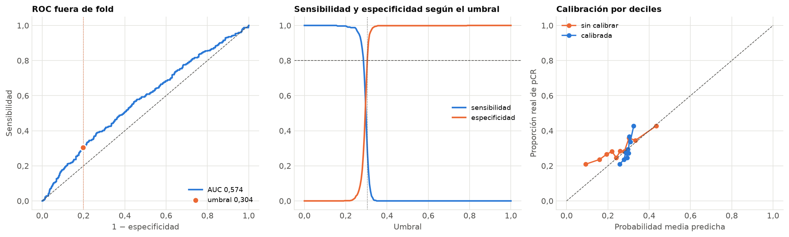

# Cierre del modelo

Generado por `python -m src.evaluation.cerrar_modelo` el 2026-10-21 21:51.
Todo con predicciones **fuera de fold** de train; test no se ha usado. Explicación de cada
decisión: [`COMO_SE_HIZO.md`](../../COMO_SE_HIZO.md).

## 1. Qué modelo

- **Versión:** cnn_v3. Motivo: empata con cnn_v2 (0,593 ± 0,032); cnn_v2 sobreajusta (diferencia 0,162 > 0,15) y cnn_v3 no (0,080).
- **Pérdida:** normal. Motivo: la ponderada no supera a la normal en más de una desviación: se queda la normal.
- **Validación cruzada usada:** `20261020-192927_cv_cnn_v3_completo`.
- **AUC en validación (5 folds):** 0,576 ± 0,037; en entrenamiento 0,656; diferencia media 0,080.
- **Modelo final:** media de los logits de los 5 modelos de esa validación cruzada (huella del modelo `b193afa060fd`).

## 2. Calibración (Platt)

logit calibrado = 0,147 · logit + (-0,708). Error de Brier por paciente: 0,2095 sin calibrar → 0,2068 calibrado (menos es mejor; 0,25 sería decir siempre 0,5).

## 3. Agregación por paciente (1097 pacientes, 322 con pCR)

| Agregación | AUC | IC 95 % (bootstrap) |
|---|---|---|
| media **(elegida)** | 0,574 | 0,535–0,614 |
| mediana | 0,572 | 0,534–0,612 |
| máximo | 0,580 | 0,542–0,619 |
| voto | 0,563 | 0,530–0,597 |

## 4. Umbral

| Criterio | Umbral | Sensibilidad | Especificidad | Precision pCR | F1 pCR | F1 no pCR | F1 macro |
|---|---|---|---|---|---|---|---|
| máxima sensibilidad con especificidad ≥ 0,80 **(elegido)** | 0,304 | 0,304 | 0,803 | 0,390 | 0,342 | 0,767 | 0,555 |
| máximo de sensibilidad + especificidad − 1 | 0,302 | 0,388 | 0,735 | 0,379 | 0,383 | 0,739 | 0,561 |
| máxima F1 macro | 0,302 | 0,388 | 0,735 | 0,379 | 0,383 | 0,739 | 0,561 |
| umbral por defecto | 0,500 | 0,000 | 0,999 | 0,000 | 0,000 | 0,827 | 0,414 |

Con el umbral elegido, fuera de fold: VP 98, FN 224, FP 153, VN 622.

## 5. Por cohorte (fuera de fold)

| Cohorte | Pacientes | Con pCR | AUC | IC 95 % |
|---|---|---|---|---|
| Duke | 209 | 44 | 0,505 | 0,409–0,598 |
| I-SPY1 | 104 | 26 | 0,529 | 0,396–0,673 |
| I-SPY2 | 784 | 252 | 0,579 | 0,537–0,622 |

## 6. Exportación

| Fichero | Época | AUC del fold | sha256 |
|---|---|---|---|
| `models/final/fold_0.pt` | 1 | 0,566 | `7b9ecf9d88b01e5a…` |
| `models/final/fold_1.pt` | 6 | 0,537 | `70a4916e0d2432b6…` |
| `models/final/fold_2.pt` | 5 | 0,635 | `5b18599b70cbd0cc…` |
| `models/final/fold_3.pt` | 16 | 0,563 | `2bbf7bdb6131bd83…` |
| `models/final/fold_4.pt` | 6 | 0,579 | `2a1ac74dae0b4681…` |

Comprobación: cada modelo recargado desde `models/final/` reproduce las predicciones del entrenamiento con una diferencia máxima de 8.9e-08.

