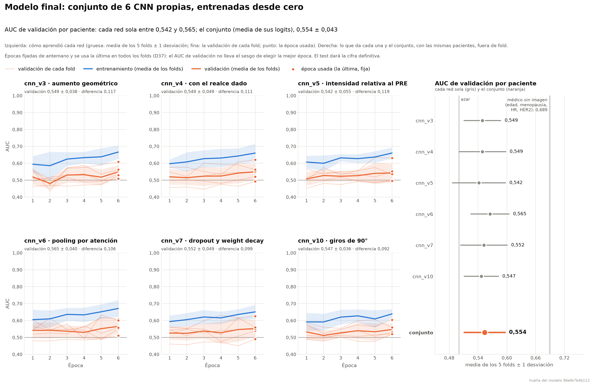

# Cierre del modelo

Generado por `python -m src.evaluation.cerrar_modelo` el 2026-10-28 21:31.
Todo con predicciones **fuera de fold** de train; test no se ha usado.

## 1. Qué modelo

- **Modelo:** conjunto de 6 CNN. Motivo: todas las versiones con validación cruzada completa que no sobreajustan (diferencia ≤ 0,15): cnn_v3, cnn_v4, cnn_v5, cnn_v6, cnn_v7, cnn_v10.
- **Pérdida:** normal. Motivo: las versiones se compararon con la pérdida normal; con cnn_v3, la ponderada da el mismo AUC (rúbrica, punto 6).

| Versión | AUC val (5 folds) | Train − val | Parámetros | Validación cruzada |
|---|---|---|---|---|
| cnn_v3 | 0,549 ± 0,038 | 0,117 | 97.809 | `20261028-195129_cv_cnn_v3_fijo` |
| cnn_v4 | 0,549 ± 0,049 | 0,111 | 98.097 | `20261028-211140_cv_cnn_v4_fijo` |
| cnn_v5 | 0,542 ± 0,055 | 0,119 | 97.809 | `20261028-205529_cv_cnn_v5_fijo` |
| cnn_v6 | 0,565 ± 0,040 | 0,106 | 101.970 | `20261028-202321_cv_cnn_v6_fijo` |
| cnn_v7 | 0,552 ± 0,049 | 0,099 | 97.809 | `20261028-203931_cv_cnn_v7_fijo` |
| cnn_v10 | 0,547 ± 0,036 | 0,092 | 97.809 | `20261028-200725_cv_cnn_v10_fijo` |

- **AUC en validación (5 folds):** 0,554 ± 0,043; en entrenamiento 0,658; diferencia media 0,107. AUC de entrenamiento y diferencia: media de las versiones del conjunto (cada una se midió en su validación cruzada).
- **Modelo final:** media de los logits de los 5 modelos de cada versión (uno por fold) y media entre las 6 versiones: 30 CNN propias desde cero (huella del modelo `86efe7b4b112`).

## 2. Calibración (Platt)

logit calibrado = 0,187 · logit + (-0,688). Error de Brier por paciente: 0,2093 sin calibrar → 0,2068 calibrado (menos es mejor; 0,25 sería decir siempre 0,5).

## 3. Agregación por paciente (1097 pacientes, 322 con pCR)

| Agregación | AUC | IC 95 % (bootstrap) |
|---|---|---|
| media **(elegida)** | 0,546 | 0,510–0,584 |
| mediana | 0,546 | 0,508–0,584 |
| máximo | 0,548 | 0,511–0,587 |
| voto | 0,530 | 0,497–0,563 |

## 4. Umbral

| Criterio | Umbral | Sensibilidad | Especificidad | Precision pCR | F1 pCR | F1 no pCR | F1 macro |
|---|---|---|---|---|---|---|---|
| máxima sensibilidad con especificidad ≥ 0,80 **(elegido)** | 0,307 | 0,283 | 0,801 | 0,371 | 0,321 | 0,763 | 0,542 |
| máximo de sensibilidad + especificidad − 1 | 0,308 | 0,261 | 0,827 | 0,385 | 0,311 | 0,775 | 0,543 |
| máxima F1 macro | 0,307 | 0,292 | 0,794 | 0,370 | 0,326 | 0,760 | 0,543 |
| umbral por defecto | 0,500 | 0,000 | 0,999 | 0,000 | 0,000 | 0,827 | 0,414 |

Con el umbral elegido, fuera de fold: VP 91, FN 231, FP 154, VN 621.

## 5. Por cohorte (fuera de fold)

| Cohorte | Pacientes | Con pCR | AUC | IC 95 % |
|---|---|---|---|---|
| Duke | 209 | 44 | 0,485 | 0,393–0,572 |
| I-SPY1 | 104 | 26 | 0,497 | 0,355–0,634 |
| I-SPY2 | 784 | 252 | 0,544 | 0,500–0,587 |

## 6. Exportación

| Fichero | Época | AUC del fold | sha256 |
|---|---|---|---|
| `experimentos/modelo_final/cnn_v3/fold_0.pt` | 6 | 0,508 | `bc6f3afbbc520a65…` |
| `experimentos/modelo_final/cnn_v3/fold_1.pt` | 6 | 0,536 | `e04604728c5e7f37…` |
| `experimentos/modelo_final/cnn_v3/fold_2.pt` | 6 | 0,563 | `56f7213320577e68…` |
| `experimentos/modelo_final/cnn_v3/fold_3.pt` | 6 | 0,529 | `508506543f3f1c9b…` |
| `experimentos/modelo_final/cnn_v3/fold_4.pt` | 6 | 0,608 | `5eff588459aaf7da…` |
| `experimentos/modelo_final/cnn_v4/fold_0.pt` | 6 | 0,520 | `06f5a47671e156ca…` |
| `experimentos/modelo_final/cnn_v4/fold_1.pt` | 6 | 0,551 | `42ae3f4d6ac40e0a…` |
| `experimentos/modelo_final/cnn_v4/fold_2.pt` | 6 | 0,562 | `396575763d685c5a…` |
| `experimentos/modelo_final/cnn_v4/fold_3.pt` | 6 | 0,492 | `24b64e8bda0cb2d4…` |
| `experimentos/modelo_final/cnn_v4/fold_4.pt` | 6 | 0,621 | `b7bc50ca7c80ad1f…` |
| `experimentos/modelo_final/cnn_v5/fold_0.pt` | 6 | 0,496 | `94a6dd0cbdc740f6…` |
| `experimentos/modelo_final/cnn_v5/fold_1.pt` | 6 | 0,495 | `ee169b5564172897…` |
| `experimentos/modelo_final/cnn_v5/fold_2.pt` | 6 | 0,535 | `9dc6308fb129acb8…` |
| `experimentos/modelo_final/cnn_v5/fold_3.pt` | 6 | 0,552 | `dd1e867a7f3837fa…` |
| `experimentos/modelo_final/cnn_v5/fold_4.pt` | 6 | 0,630 | `ddca3039ad440b97…` |
| `experimentos/modelo_final/cnn_v6/fold_0.pt` | 6 | 0,549 | `3a8c4d4cc9180651…` |
| `experimentos/modelo_final/cnn_v6/fold_1.pt` | 6 | 0,557 | `ab8aa68330e9f11e…` |
| `experimentos/modelo_final/cnn_v6/fold_2.pt` | 6 | 0,607 | `4430aef08395cd36…` |
| `experimentos/modelo_final/cnn_v6/fold_3.pt` | 6 | 0,510 | `d11280ef9af2bd01…` |
| `experimentos/modelo_final/cnn_v6/fold_4.pt` | 6 | 0,601 | `9afba15218b1870d…` |
| `experimentos/modelo_final/cnn_v7/fold_0.pt` | 6 | 0,538 | `264ab64d681b7a1b…` |
| `experimentos/modelo_final/cnn_v7/fold_1.pt` | 6 | 0,548 | `05b056ce4197f709…` |
| `experimentos/modelo_final/cnn_v7/fold_2.pt` | 6 | 0,559 | `59b51dc40f1dd001…` |
| `experimentos/modelo_final/cnn_v7/fold_3.pt` | 6 | 0,490 | `14477a970dad103e…` |
| `experimentos/modelo_final/cnn_v7/fold_4.pt` | 6 | 0,625 | `34d4b6a4a741d0b6…` |
| `experimentos/modelo_final/cnn_v10/fold_0.pt` | 6 | 0,521 | `a92ec91a5892530d…` |
| `experimentos/modelo_final/cnn_v10/fold_1.pt` | 6 | 0,530 | `ac590f3bc8b04160…` |
| `experimentos/modelo_final/cnn_v10/fold_2.pt` | 6 | 0,559 | `f1437dad11b1e31f…` |
| `experimentos/modelo_final/cnn_v10/fold_3.pt` | 6 | 0,520 | `be8390e719ede570…` |
| `experimentos/modelo_final/cnn_v10/fold_4.pt` | 6 | 0,604 | `6250d90f4af375df…` |

Comprobación: cada modelo recargado desde `experimentos/modelo_final/` reproduce las predicciones del entrenamiento con una diferencia máxima de 2.1e-07.

