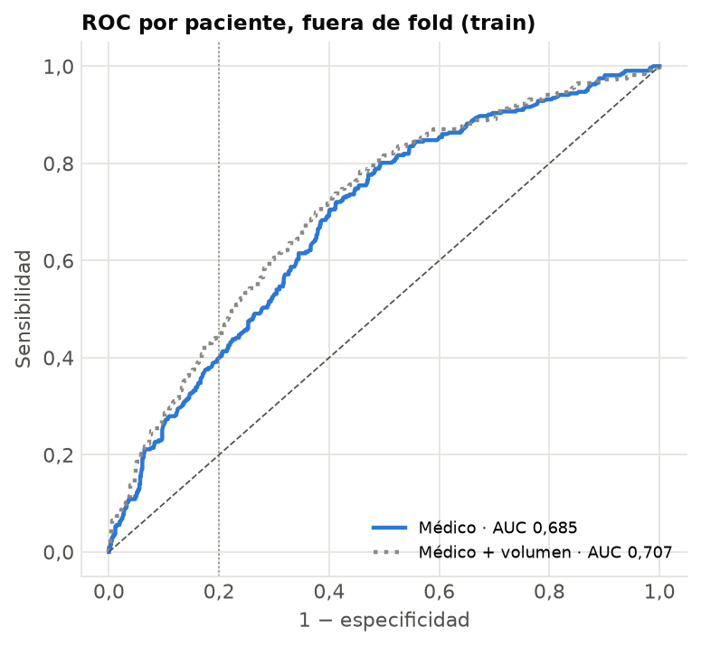
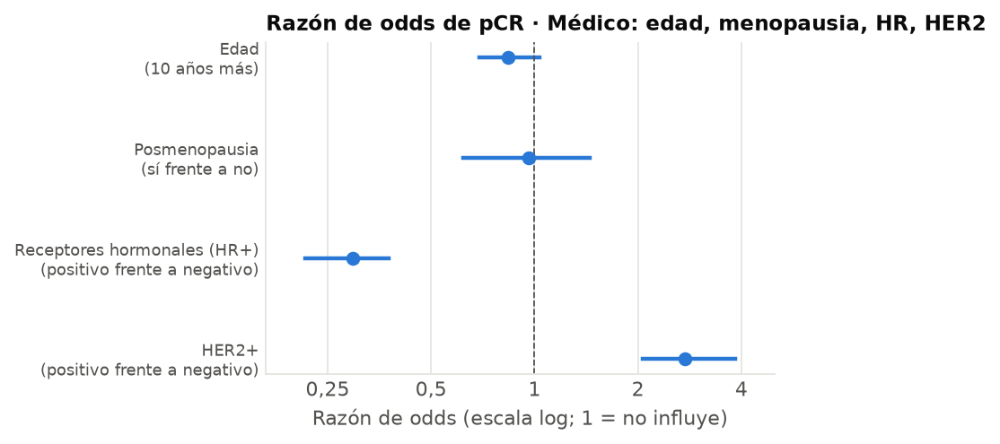

# Modelo clínico de comparación (sin imagen)

Generado por `python -m src.evaluation.modelo_clinico` el 2026-10-20 08:42. Solo train, con
los mismos 5 folds que la CNN; test no se ha usado (se evalúa una sola vez, junto con la CNN, en `evaluar_test`).
Por qué y cómo: D25 en [`COMO_SE_HIZO.md`](../../COMO_SE_HIZO.md#25-el-modelo-del-médico-sin-imagen-d25).

**Para qué sirve.** Es lo que sabría un médico antes de la quimioterapia sin mirar la resonancia. Si la CNN no lo
supera, la imagen (tal como la usamos) aporta menos que la biopsia. **No entra en la CNN ni en la app**: el profesor
pide estas variables como comparación, no como modelo principal.

## 1. Qué sabe el médico

| Variable | Para qué | % que falta en train: Duke · I-SPY1 · I-SPY2 |
|---|---|---|
| `age` · Edad | edad de la paciente | 0,0 % · 0,0 % · 0,4 % |
| `menopause` · Posmenopausia | estado menopáusico (1 = posmenopausia) | 0,0 % · 100,0 % · 3,8 % |
| `HR` · Receptores hormonales (HR+) | receptores hormonales en la biopsia | 0,0 % · 1,9 % · 0,0 % |
| `HER2` · HER2+ | HER2 en la biopsia | 0,0 % · 2,9 % · 0,0 % |
| `tum_vol` · Volumen tumoral | solo en la variante (sale de la imagen) | 0,5 % · 0,0 % · 0,0 % |

Lo que falta se completa con lo aprendido en los folds de entrenamiento: la mediana; la menopausia, con la
probabilidad de posmenopausia según la edad (falta entera en I-SPY1). Sin indicador de «falta el dato», que en
I-SPY1 delataría la cohorte.

**El dataset no trae análisis de sangre, peso, IMC, tabaco ni alcohol** (guía). Lo que no se usa:

| Columnas | Por qué no |
|---|---|
| `race_white, race_black` | raza: tratarla como causa es un error metodológico (guía, D4) |
| `dataset` | cohorte: es del dataset, no de la paciente (R0 mide cuánto acierta sola) |
| `n_xy, n_z, n_times, pre, post_early, post_late, slice_thick, xy_spacing` | adquisición de la resonancia: no es información clínica |
| `mask_start, mask_end, sraw, eraw, scol, ecol` | localización de la máscara: sale de la imagen |
| `tum_vol` | volumen tumoral: sale de la segmentación de la imagen y en Duke tiene otra escala; solo como variante aparte |
| `HR_HER2_STATUS, TripleNeg, HER2pos, HRposHER2neg` | son combinaciones de HR y HER2, que ya están |

## 2. Resultados en validación cruzada (1097 pacientes, 322 con pCR)

| Modelo | AUC validación (5 folds) | AUC entrenamiento | Diferencia | AUC fuera de fold (IC 95 %) | Sensibilidad | Especificidad |
|---|---|---|---|---|---|---|
| Solo la cohorte (R0) | 0,549 ± 0,027 | — | — | — | — | — |
| Solo el subtipo HR/HER2 (R0) | 0,657 ± 0,028 | — | — | — | — | — |
| **Médico: edad, menopausia, HR, HER2** | 0,689 ± 0,024 | 0,700 | 0,010 | 0,685 (0,65–0,72) | 0,398 | 0,803 |
| Médico + volumen tumoral | 0,711 ± 0,030 | 0,720 | 0,010 | 0,707 (0,67–0,74) | 0,444 | 0,801 |

Sensibilidad y especificidad con el umbral de cada modelo elegido con el mismo criterio que la CNN (mayor sensibilidad con especificidad ≥ 0,80).
El volumen se prueba solo como variante: sale de la segmentación de la imagen y en Duke tiene otra escala, así que no es «lo que sabe el médico» y no se lleva a test.

## 3. Qué pesa cada variable (modelo ajustado con todo train)

| Variable | Cambio | Razón de odds de pCR (IC 95 %, bootstrap) |
|---|---|---|
| Edad | 10 años más | 0,84 (0,69–1,03) |
| Posmenopausia | sí frente a no | 0,96 (0,62–1,45) |
| Receptores hormonales (HR+) | positivo frente a negativo | 0,30 (0,22–0,38) |
| HER2+ | positivo frente a negativo | 2,74 (2,06–3,84) |

Razón de odds > 1: más probable la pCR; < 1: menos; si el intervalo cruza el 1, no se puede afirmar que influya. Son asociaciones en este dataset, no causas.

## 4. CNN frente al médico

Pendiente: la CNN aún no está cerrada (falta models/final/manifiesto.json). Se completa ejecutando de nuevo este script después de `cerrar_modelo`.

**Por cohorte (AUC fuera de fold del médico).**

| Cohorte | Pacientes | Con pCR | Médico |
|---|---|---|---|
| Duke | 209 | 44 | 0,717 |
| I-SPY1 | 104 | 26 | 0,796 |
| I-SPY2 | 784 | 252 | 0,663 |

## 5. Cómo leerlo

- Es el listón que la CNN tiene que superar para decir que la imagen aporta algo que no sabe ya el médico.
- Las diferencias de AUC se juzgan por su intervalo: si cruza el 0, no hay pruebas de que un modelo sea mejor que otro.
- En la bibliografía pasa lo mismo: en Joo et al. 2021 la clínica sola daba 0,83 y la imagen la subía a 0,89.
- Modelo guardado en `models/clinico/modelo_clinico.json` (huella `9f3b8287`): lo usa `evaluar_test`.
