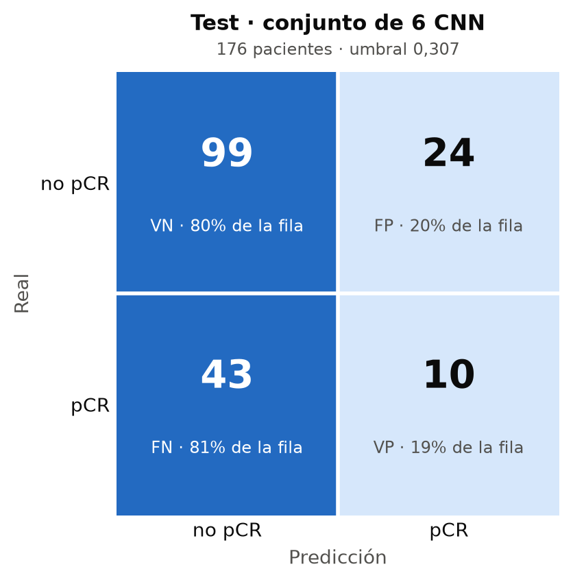
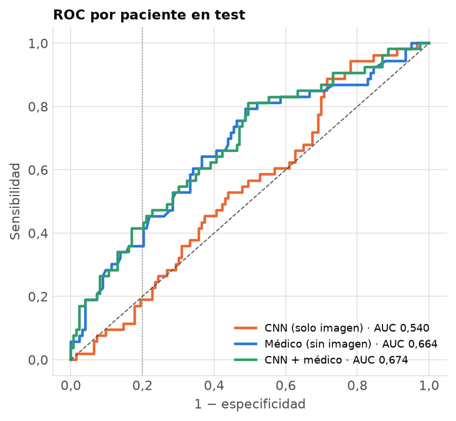
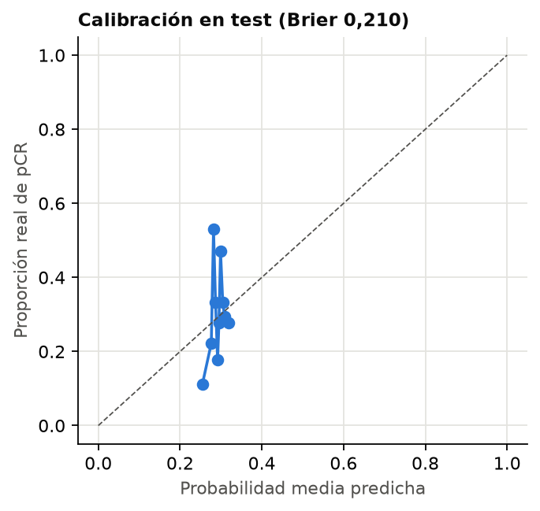
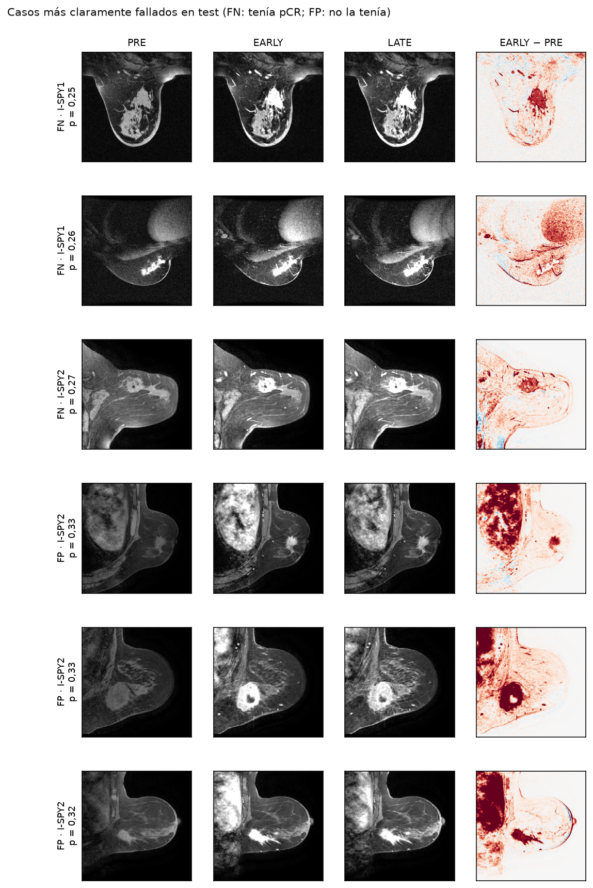

# Resultado en test

Evaluado el 2026-10-29 14:36 con `python -m src.evaluation.evaluar_test`. **Evaluación única:** el modelo
estaba cerrado (versión conjunto de 6 CNN, huella `86efe7b4b112`, umbral 0,307, media de cortes) y no se ha tocado después.

## Métricas por paciente (176 pacientes, 53 con pCR)

| Métrica | Test | Fuera de fold (train) | Siempre «no pCR» | Siempre «pCR» |
|---|---|---|---|---|
| AUC | 0,540 (IC 95 % 0,450–0,630) | 0,546 (media de folds 0,554) | 0,500 | 0,500 |
| Sensibilidad (recall pCR) | 0,189 (IC 0,09–0,30) | 0,283 | 0 | 1 |
| Especificidad (recall no pCR) | 0,805 (IC 0,73–0,87) | 0,801 | 1 | 0 |
| Precision pCR | 0,294 | 0,371 | — | 0,301 |
| Precision no pCR (VPN) | 0,697 | 0,729 | 0,699 | — |
| F1 pCR | 0,230 | 0,321 | 0,000 | 0,463 |
| F1 no pCR | 0,747 | 0,763 | 0,823 | 0,000 |
| F1 macro | 0,489 | 0,542 | 0,411 | 0,231 |
| Accuracy | 0,619 | 0,649 | 0,699 | 0,301 |

Matriz de confusión: VP 10, FN 43, FP 24, VN 99. Error de Brier: 0,2095 (decir a todas la tasa de pCR de train, 29,4 %, da 0,2105).

Estimación interna sin el fold que se mide (Platt y umbral elegidos sin él, D40): sensibilidad 0,280, especificidad 0,805, precisión pCR 0,373. La columna «fuera de fold» usa las mismas pacientes con las que se eligieron, así que es algo optimista.

## Por cohorte

| Cohorte | Pacientes | Con pCR | AUC (IC 95 %) | Sensibilidad | Especificidad |
|---|---|---|---|---|---|
| Duke | 42 | 9 | 0,731 (0,52–0,90) | 0,333 | 0,970 |
| I-SPY1 | 35 | 12 | 0,348 (0,18–0,53) | 0,000 | 0,913 |
| I-SPY2 | 99 | 32 | 0,514 (0,40–0,63) | 0,219 | 0,687 |

Con tan pocas pacientes por cohorte los intervalos son muy anchos: las diferencias entre
cohortes se describen, no se afirman.

## Comparación con el médico (modelo clínico sin imagen, D25)

Mismas pacientes de test. Cada modelo con su umbral elegido en train con el mismo criterio. El médico usa edad,
menopausia, HR y HER2; no entra en la app. Detalle en [`MODELO_CLINICO.md`](../3_clinico/MODELO_CLINICO.md).

| Modelo | AUC (IC 95 %) | Sensibilidad | Especificidad | Precision pCR | F1 macro | Brier |
|---|---|---|---|---|---|---|
| CNN (solo imagen) | 0,540 (0,45–0,63) | 0,189 | 0,805 | 0,294 | 0,489 | 0,210 |
| Médico (sin imagen) | 0,664 (0,57–0,76) | 0,396 | 0,797 | 0,457 | 0,599 | 0,193 |
| CNN + médico | 0,674 (0,58–0,76) | 0,434 | 0,797 | 0,479 | 0,618 | 0,191 |

| Diferencia de AUC (bootstrap pareado de pacientes) | Valor (IC 95 %) |
|---|---|
| CNN − médico | -0,125 (-0,259 a 0,009) |
| (CNN + médico) − médico: lo que añade la imagen | 0,009 (-0,006 a 0,026) |

Si el intervalo de una diferencia cruza el 0, con 176 pacientes no hay pruebas de que un modelo sea
mejor que el otro.

## Conjunto de 30 frente a los de 6 (D40)

Platt y el umbral se ajustaron con predicciones de 6 redes por paciente (las de su fold); la app y esta evaluación usan las 30. Solo se describe qué cambia; no se ha ajustado nada.

| Conjunto | AUC | Desviación del logit | Por encima del umbral | Sensibilidad | Especificidad |
|---|---|---|---|---|---|
| Fuera de fold en train (6 redes) | — | 0,114 | 22,3 % | — | — |
| 30 redes (el modelo final) | 0,540 | 0,088 | 19,3 % | 0,189 | 0,805 |
| 6 redes del fold 0 | 0,540 | 0,086 | 13,6 % | 0,170 | 0,878 |
| 6 redes del fold 1 | 0,533 | 0,117 | 28,4 % | 0,302 | 0,724 |
| 6 redes del fold 2 | 0,575 | 0,078 | 23,3 % | 0,283 | 0,789 |
| 6 redes del fold 3 | 0,547 | 0,119 | 31,2 % | 0,283 | 0,675 |
| 6 redes del fold 4 | 0,485 | 0,086 | 14,8 % | 0,075 | 0,821 |

Si con 30 redes la desviación es menor que con 6, la probabilidad sale más concentrada y caen menos pacientes por encima del umbral: la sensibilidad baja y la especificidad sube.

## Calibración y casos fallados

## Cómo leerlo

- Con 176 pacientes, el IC del AUC mide unos ±0,08: una diferencia de 0,02 con otro modelo no
  significa nada (correo del profesor).
- Referencias: lo publicado con imagen pretratamiento y test independiente está entre 0,70 y
  0,80; con cortes 2D y tres cohortes, 0,60–0,70 es un buen trabajo; Fridman et al. obtienen
  0,72 en este mismo test con un ViT preentrenado (método no permitido aquí).
- La diferencia entre fuera de fold y test indica cuánto se pierde con pacientes nuevas.
